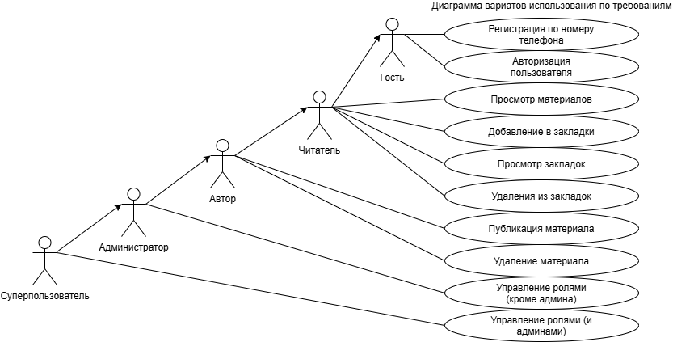
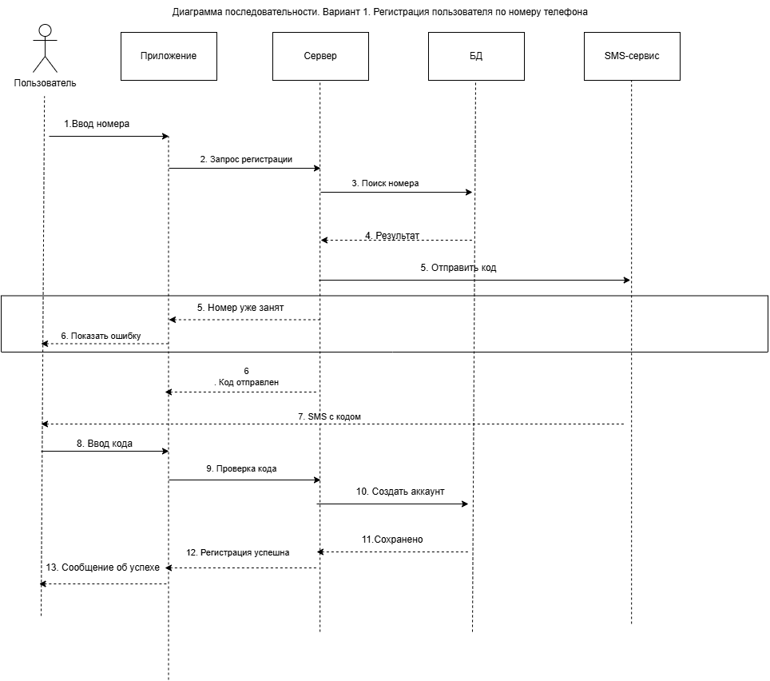
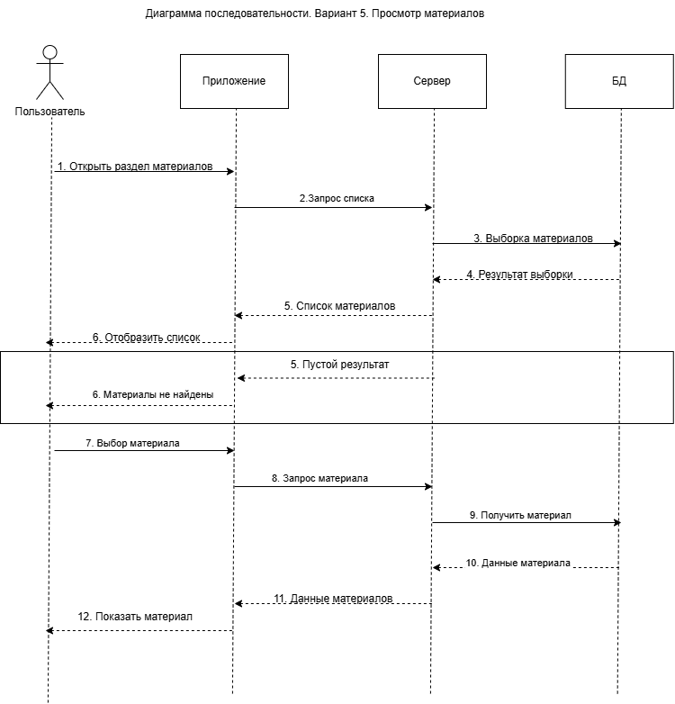
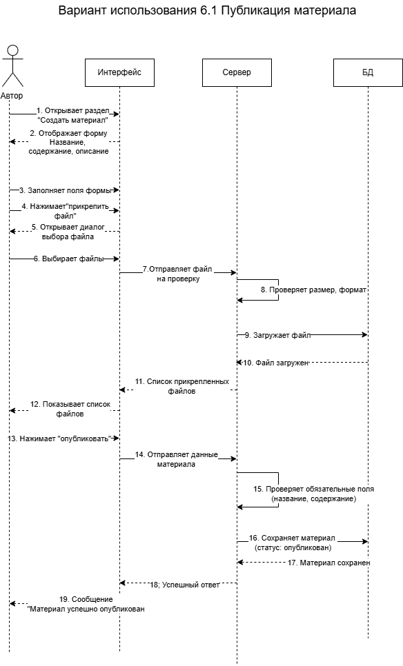

# Портал образовательных материалов — общий отчёт по ПЗ 1–4

> ФГБОУ ВО «РГАУ–МСХА имени К.А. Тимирязева»
> Общий отчёт команды: сбор и анализ требований, функциональные и нефункциональные требования, варианты использования и диаграммы, организация Git-репозитория.

## Оглавление

- [Материалы отчёта](#материалы-отчёта)
  - [Индивидуальные отчёты](#индивидуальные-отчёты)
- [1. О проекте](#1-о-проекте)
  - [Команда](#команда)
  - [Состав работ](#состав-работ)
- [2. ПЗ-1. Сбор и анализ требований](#2-пз-1-сбор-и-анализ-требований)
  - [Блок 1: Общие сведения и цели](#блок-1-общие-сведения-и-цели)
  - [Блок 2: Пользователи и права доступа](#блок-2-пользователи-и-права-доступа)
  - [Блок 3: Функциональность (Что должна делать система?)](#блок-3-функциональность-что-должна-делать-система)
  - [Блок 4: Нефункциональные требования и ограничения](#блок-4-нефункциональные-требования-и-ограничения)
- [3. ПЗ-2. Функциональные и нефункциональные требования](#3-пз-2-функциональные-и-нефункциональные-требования)
  - [Назначение системы](#назначение-системы)
  - [Роли в системе](#роли-в-системе)
  - [Функциональные требования для роли «Читатель»](#функциональные-требования-для-роли-читатель)
  - [Функциональные требования для роли «Автор»](#функциональные-требования-для-роли-автор)
  - [Функциональные требования для роли «Администратор»](#функциональные-требования-для-роли-администратор)
  - [Нефункциональные требования](#нефункциональные-требования)
  - [Нефункциональные требования для читателя](#нефункциональные-требования-для-читателя)
  - [Нефункциональные требования для автора](#нефункциональные-требования-для-автора)
  - [Нефункциональные требования для администратора](#нефункциональные-требования-для-администратора)
- [4. ПЗ-3. Варианты использования и диаграммы](#4-пз-3-варианты-использования-и-диаграммы)
  - [Трассировка: требования → варианты использования](#трассировка-требования--варианты-использования)
  - [Вариант использования 1: «Регистрация пользователя по номеру телефона»](#вариант-использования-1-регистрация-пользователя-по-номеру-телефона)
  - [Вариант использования 2: «Авторизация пользователя»](#вариант-использования-2-авторизация-пользователя)
  - [Вариант использования 3: «Управление ролями пользователей»](#вариант-использования-3-управление-ролями-пользователей)
  - [Вариант использования 4.1: «Добавление материала в закладки»](#вариант-использования-41-добавление-материала-в-закладки)
  - [Вариант использования 4.2: «Просмотр закладок»](#вариант-использования-42-просмотр-закладок)
  - [Вариант использования 4.3: «Удаление материала из закладок»](#вариант-использования-43-удаление-материала-из-закладок)
  - [Вариант использования 5: «Просмотр материалов»](#вариант-использования-5-просмотр-материалов)
  - [Вариант использования 6.1: «Публикация материала»](#вариант-использования-61-публикация-материала)
  - [Вариант использования 6.2: «Удаление материала»](#вариант-использования-62-удаление-материала)
  - [Сводная таблица распределения вариантов использования](#сводная-таблица-распределения-вариантов-использования)
- [5. ПЗ-4. Организация репозитория](#5-пз-4-организация-репозитория)
  - [Площадка размещения](#площадка-размещения)
  - [Структура репозитория](#структура-репозитория)
  - [Индивидуальный вклад участников](#индивидуальный-вклад-участников)
  - [Соответствие версий документов](#соответствие-версий-документов)
- [6. Результаты проверок](#6-результаты-проверок)
- [7. Ключевые решения и параметры](#7-ключевые-решения-и-параметры)
- [8. Выводы](#8-выводы)

## Материалы отчёта

**Общий отчёт для сдачи (Word):** [report.docx](report.docx)

### Индивидуальные отчёты

| Участник | Роль | Выполненная часть | Markdown | Word |
|---|---|---|---|---|
| Лушникова Анна | Fullstack-разработчик | UC-1 «Регистрация пользователя по номеру телефона», UC-2 «Авторизация пользователя» (ФТ-1, ФТ-2) | [lushnikova-report.md](md/lushnikova-report.md) | [lushnikova-report.docx](doc/lushnikova-report.docx) |
| Филимонова Евгения | Аналитик данных | UC-3 «Управление ролями пользователей», UC-5 «Просмотр материалов» (ФТ-3, ФТ-19) | [filimonova-report.md](md/filimonova-report.md) | [filimonova-report.docx](doc/filimonova-report.docx) |
| Гринь Вероника | Backend-разработчик | UC-4.1 «Добавление материала в закладки», UC-4.2 «Просмотр закладок», UC-4.3 «Удаление материала из закладок» (ФТ-4) | [grin-report.md](md/grin-report.md) | [grin-report.docx](doc/grin-report.docx) |
| Хоптяная Мария | UI/UX-дизайнер | UC-6.1 «Публикация материала», UC-6.2 «Удаление материала» (ФТ-10, ФТ-11, ФТ-13) | [khoptyanaya-report.md](md/khoptyanaya-report.md) | [khoptyanaya-report.docx](doc/khoptyanaya-report.docx) |

Все варианты использования согласованы с: **Храмов Дмитрий Эдуардович**.

---

## 1. О проекте

Веб-портал для публикации и чтения образовательных материалов. Основная аудитория — студенты бакалавриата. Читатели просматривают статьи, сохраняют закладки и цитаты, скачивают материалы для офлайн-чтения. Авторы публикуют материалы и прикрепляют файлы. Администраторы управляют пользователями, ролями и контентом.

Срок разработки MVP — 4 месяца (до конца семестра).

**Цель продукта:** проект направлен на создание веб-приложения для публикации и просмотра статей и других учебных материалов.

**Ссылка на репозиторий:** <https://github.com/donsgipsy/library-university.git>

### Команда

| Участник | Роль в команде | Варианты использования (ПЗ-3) |
|---|---|---|
| Лушникова Анна | Fullstack-разработчик | 1, 2 |
| Филимонова Евгения | Аналитик данных | 3, 5 |
| Гринь Вероника | Backend-разработчик | 4.1, 4.2, 4.3 |
| Хоптяная Мария | UI/UX-дизайнер | 6.1, 6.2 |

### Состав работ

| Часть | Тема | Раздел отчёта |
|---|---|---|
| ПЗ-1 | Сбор и анализ требований (интервью с заказчиком) | [Раздел 2](#2-пз-1-сбор-и-анализ-требований) |
| ПЗ-2 | Функциональные и нефункциональные требования | [Раздел 3](#3-пз-2-функциональные-и-нефункциональные-требования) |
| ПЗ-3 | Варианты использования и диаграммы | [Раздел 4](#4-пз-3-варианты-использования-и-диаграммы) |
| ПЗ-4 | Организация репозитория командного проекта | [Раздел 5](#5-пз-4-организация-репозитория) |

---

## 2. ПЗ-1. Сбор и анализ требований

**Цель работы.** Получить практические навыки выявления, сбора, уточнения и первичного анализа требований к разрабатываемому программному продукту посредством взаимодействия с заказчиком.

Проведено структурированное интервью с заказчиком по четырём блокам: цели, пользователи и права, функциональность, нефункциональные требования и ограничения. Итог — исходные пожелания заказчика: регистрация по номеру телефона, роли (читатель / модератор / автор / админ), закладки, цитаты, HTML-версии статей офлайн, смена пароля раз в полгода.

### Блок 1: Общие сведения и цели

1.  Какова основная цель создания данного приложения? Какую главную проблему пользователя оно решает? (портал для образовательных материалов публикация

2.  Кто является целевой аудиторией? (студенты бакалавры

3.  Какие существующие аналоги вас не устраивают или что вы хотите улучшить по сравнению с ними? (не смотрел, свой портал)

4.  какие материалы. файлы, полноценные страницы, файловые версии, можно было скачать 

### Блок 2: Пользователи и права доступа

1.  Чем отличаются права доступа у разных категорий пользователей? (кто хочет регистрируется, нужна админка: управлять ролями пользователей (можно перевести обычного пользователя в роль модера или публикатора, вручную создать удалять просматривать логи сайта сервера возможность тестирования закрытого функционала не доступного пользователям. читатель, модер, автор, обычные пользователи могут читать, закладки, сам пользователь не может повысить ранг 

2.  Нужна ли регистрация/авторизация? да. Если да, то через какие методы (email, соцсети)? регистрация с помощью номера телефона 

### Блок 3: Функциональность (Что должна делать система?)

1.  Какие основные действия должен выполнять пользователь при использовании приложения? (может читать весь материал, что то сохранять, цитаты, закладки, статьи 

2.  Нужна ли интеграция с внешними сервисами? (нет) 

3.  Должна ли система работать офлайн? (есть возможность скачивать статьи, хтмл на телефон)

### Блок 4: Нефункциональные требования и ограничения

1.  На каких платформах должно работать приложение? (iOS, Android, Web, или кроссплатформенное решение .NET MAUI?)  (везде, мобильная, веб, десктоп, ИМЕННО САЙТ)

2.  Какие требования к безопасности данных пользователей (хранение платежных данных, персональных данных)? (сбрасывался пароль, каждые полгода просят создать новый пароль, уведомить пользователя через уведомление в лк, подтверждать регистрацию нужно, 

Есть ли ограничения по срокам разработки MVP (минимально жизнеспособного продукта)? (через 4 месяца к концу семестра

---

## 3. ПЗ-2. Функциональные и нефункциональные требования

Из ответов заказчика сформированы три роли (Читатель, Автор, Администратор) с правами и ограничениями, **26 функциональных требований** (ФТ-1…ФТ-26) и нефункциональные требования: общие и отдельно для каждой роли.

### Назначение системы

Портал для публикации образовательных материалов преимущественно для студентов бакалавриата.

### Роли в системе

#### Читатель

Регистрация: Автоматическая после подтверждения номера телефона через SMS-код.

Права доступа:

- Просмотр всех опубликованных материалов (статьи, файлы, веб-страницы)

- Создание персональных закладок для быстрого доступа к материалам

- Сохранение цитат из текста статей

- Скачивание статей в формате HTML для чтения в офлайн-режиме

- Скачивание прикрепленных файлов на устройство

- Обращение в техническую поддержку через встроенный модуль

- Просмотр уведомлений в личном кабинете (например, о необходимости смены пароля)

Ограничения:

- Не может публиковать собственные материалы

- Не может редактировать контент других пользователей

- Не может изменять свою роль самостоятельно

- Не имеет доступа к административным функциям

#### Администратор

Назначение: Изначально создается при развертывании системы или назначается текущим администратором.

Права доступа (полный доступ к системе):

- Управление пользователями: создание, блокировка, удаление учетных записей

- Назначение и снятие ролей (перевод Читателя в Автора и обратно)

- Просмотр логов сервера (ошибки, действия пользователей, попытки входа, системные события)

- Доступ к закрытому функционалу для тестирования новых возможностей до их релиза

- Управление всеми материалами в системе (публикация, редактирование, удаление)

- Настройка параметров системы и политик безопасности

- Мониторинг активности пользователей и выявление нарушений

- Рассылка системных уведомлений всем пользователям

Ограничения:

- Отсутствуют (полный контроль над системой)

#### Автор

Назначение: Вручную администратором из числа зарегистрированных пользователей.

Права доступа (дополнительно к правам Читателя):

- Создание новых статей и образовательных материалов

- Загрузка и прикрепление файлов к своим публикациям

- Редактирование собственных материалов после публикации

- Удаление собственных материалов

- Просмотр статистики просмотров своих публикаций

Ограничения:

- Не может редактировать или удалять материалы других авторов

- Не имеет доступа к логам сервера

- Не может управлять ролями других пользователей

### Функциональные требования для роли «Читатель»

#### ФТ-1. Регистрация пользователя по номеру телефона

Система должна обеспечивать регистрацию нового пользователя только после успешного подтверждения номера телефона посредством SMS-кода.

- Пользователь вводит номер телефона в международном формате.

- Система генерирует одноразовый 6-значный код и отправляет его через SMS-шлюз.

- Срок действия кода — 5 минут.

- После успешного ввода кода создаётся учётная запись с ролью «Читатель».

- До подтверждения номера доступ к функциям авторизованного пользователя не предоставляется.

#### ФТ-2. Авторизация пользователя

Система должна предоставлять возможность входа в систему по номеру телефона и SMS-коду, а также по логину и паролю (при наличии).

- При входе по SMS система отправляет одноразовый код.

- При входе по паролю система проверяет соответствие учётной записи.

- При успешной авторизации система создаёт сессию пользователя.

#### ФТ-3. Просмотр материалов

Система должна предоставлять Читателю возможность просматривать все опубликованные материалы.

- Отображение списка материалов с названием, автором, датой публикации и кратким описанием.

- Возможность фильтрации материалов по категориям, дате, автору.

- Поиск материалов по ключевым словам.

- Отображение полного содержимого статьи при переходе на неё.

- Поддержка отображения веб-страниц, статей и файловых версий.

#### ФТ-4. Работа с закладками

Система должна позволять Читателю управлять персональными закладками.

- Добавление материала в закладки одним нажатием.

- Просмотр списка всех сохранённых закладок с датой добавления.

- Переход к материалу из списка закладок.

- Удаление материала из закладок.

- Сортировка закладок по дате добавления или алфавиту.

#### ФТ-5. Сохранение цитат

Система должна предоставлять возможность выделять и сохранять фрагменты текста.

- Пользователь выделяет фрагмент текста в статье.

- Система отображает кнопку «Сохранить цитату».

- При сохранении цитата привязывается к исходному материалу и автору.

- Просмотр всех сохранённых цитат в личном профиле.

- Возможность удаления цитаты.

- Возможность добавления комментария к сохранённой цитате.

#### ФТ-6. Скачивание статей в формате HTML

Система должна предоставлять возможность скачивания статей для офлайн-просмотра.

- На странице материала отображается кнопка «Скачать HTML».

- Система генерирует HTML-файл с основным содержимым статьи, изображениями и стилями.

- Файл сохраняется на устройство пользователя.

- Скачанный файл открывается в стандартном веб-браузере.

- Возможность просмотра списка ранее скачанных статей.

#### ФТ-7. Обращение в техническую поддержку

Система должна предоставлять встроенный модуль связи с поддержкой.

- Создание нового обращения с указанием темы и описания проблемы.

- Возможность прикрепления скриншотов или файлов к обращению.

- Просмотр списка всех ранее созданных обращений.

- Отображение статуса обращения (новое, в работе, решено, отклонено).

- Просмотр ответов от технической поддержки.

#### ФТ-8. Персональные уведомления

Система должна отображать уведомления в личном кабинете пользователя.

- Уведомления о приближении окончания срока действия пароля.

- Уведомления об изменении статуса обращения в поддержку.

- Уведомления о назначении новой роли (если администратор повысил пользователя).

- Уведомления о системных событиях (рассылки от администратора).

- Возможность отметить уведомление как прочитанное.

#### ФТ-9. Просмотр и редактирование личного профиля

Система должна предоставлять пользователю доступ к личному кабинету.

- Просмотр персональных данных (номер телефона, дата регистрации, роль).

- Смена пароля (при использовании классической авторизации).

- Настройка параметров уведомлений.

- Просмотр статистики собственной активности (количество закладок, цитат, обращений).

### Функциональные требования для роли «Автор»

#### ФТ-10. Публикация материалов

Система должна предоставлять Автору возможность создавать новые материалы и публиковать их в системе.

- Открытие формы создания материала с полями: название, содержание, краткое описание, категория.

- Использование визуального редактора для форматирования текста (заголовки, списки, ссылки, изображения).

- Сохранение материала в виде черновика без публикации.

- Обязательность заполнения полей «Название» и «Содержание» перед публикацией.

- Автор нажимает кнопку «Опубликовать».

- Система проверяет заполненность обязательных полей.

- Система присваивает материалу уникальный идентификатор и дату публикации.

- Материал становится доступен всем Читателям.

- Система уведомляет автора об успешной публикации.

#### ФТ-11. Загрузка и прикрепление файлов

Система должна позволять Автору прикреплять файлы к публикациям.

- Загрузка файлов через диалог выбора на устройстве.

- Ограничение размера файла — не более 50 МБ.

- Поддерживаемые форматы: PDF, DOCX, PPTX, XLSX, PNG, JPG, ZIP.

- Отображение списка прикреплённых файлов с названием и размером.

- Возможность удаления файла до публикации.

#### ФТ-12. Редактирование собственных материалов

Система должна позволять Автору редактировать свои публикации.

- Открытие материала в режиме редактирования.

- Изменение содержания, названия, описания.

- Сохранение изменений с фиксацией даты последнего обновления.

- История изменений материала (по желанию).

#### ФТ-13. Удаление собственных материалов

Система должна позволять Автору удалять свои публикации.

- Запрос подтверждения перед удалением: «Вы уверены, что хотите удалить материал?».

- После удаления материал становится недоступен для всех пользователей.

- Прикреплённые файлы также удаляются из системы.

- Удаление материалов других авторов недоступно.

#### ФТ-14. Просмотр статистики публикаций

Система должна предоставлять Автору доступ к статистике его материалов.

- Отображение количества просмотров каждой публикации.

- Отображение даты публикации и последнего обновления.

- Статистика материалов других авторов недоступна.

#### ФТ-15. Управление прикреплёнными файлами

Система должна позволять Автору управлять файлами своих публикаций.

- Добавление новых файлов к уже опубликованному материалу.

- Замена существующего файла на новую версию.

- Удаление прикреплённого файла.

- Изменение порядка отображения файлов.

### Функциональные требования для роли «Администратор»

#### ФТ-16. Полное управление материалами

Система должна предоставлять Администратору полный контроль над контентом.

- Создание новых материалов от имени системы.

- Просмотр всех материалов в системе.

- Публикация, редактирование и удаление любых материалов независимо от автора.

- Модерация материалов перед публикацией (опционально).

#### ФТ-17. Управление файлами

Система должна позволять Администратору управлять всеми файлами.

- Просмотр списка всех загруженных файлов.

- Добавление, изменение и удаление файлов любых публикаций.

- Контроль объёма хранилища.

#### ФТ-18. Управление пользователями

Система должна предоставлять Администратору инструменты управления учётными записями.

- Просмотр списка всех зарегистрированных пользователей.

- Поиск пользователей по номеру телефона, имени, роли.

- Создание новых учётных записей вручную.

- Блокировка учётных записей (временная или постоянная).

- Удаление учётных записей с подтверждением.

#### ФТ-19. Управление ролями

Система должна позволять Администратору назначать и изменять роли пользователей.

- Назначение роли «Автор» или «Модератор» пользователю с ролью «Читатель».

- Понижение роли пользователя.

- Запись в журнал о каждом изменении роли (кто, кому, когда, с какой на какую).

- Пользователь не может изменить свою роль самостоятельно.

#### ФТ-20. Настройка параметров системы

Система должна предоставлять Администратору инструменты общей настройки.

- Изменение названия портала.

- Настройка главной страницы.

- Управление категориями материалов.

- Настройка политик модерации.

#### ФТ-21. Настройка политики безопасности

Система должна позволять Администратору управлять параметрами безопасности.

- Настройка минимальной длины пароля.

- Настройка срока действия пароля (по умолчанию 180 дней).

- Настройка требований к сложности пароля.

- Просмотр списка активных сессий пользователей.

- Принудительный сброс пароля пользователя.

#### ФТ-22. Мониторинг активности пользователей

Система должна предоставлять инструменты анализа активности.

- Просмотр последних действий пользователей (вход, публикации, изменения).

- Выявление подозрительных действий (множественные неудачные попытки входа).

- Построение графиков активности по дням/неделям.

- Фильтрация по пользователю, периоду, типу действия.

#### ФТ-23. Просмотр системных журналов

Система должна предоставлять доступ к журналам событий.

- Журнал ошибок сервера.

- Журнал действий пользователей.

- Журнал попыток входа (успешных и неудачных).

- Журнал системных событий.

- Поиск и фильтрация записей в журналах.

- Экспорт журналов в файл.

#### ФТ-24. Массовая рассылка уведомлений

Система должна позволять Администратору рассылать уведомления.

- Создание уведомления с заголовком и содержанием.

- Выбор целевой группы (все пользователи, только Авторы, только Читатели и т.д.).

- Планирование отправки (немедленно или по расписанию).

- Просмотр истории отправленных уведомлений.

#### ФТ-25. Управление обращениями в техническую поддержку

Система должна предоставлять Администратору инструменты обработки обращений.

- Просмотр списка всех обращений с фильтрацией по статусу.

- Изменение статуса обращения (новое, в работе, решено, отклонено).

- Добавление ответа на обращение.

- Назначение ответственного за обращение.

- Закрытие обращения с указанием причины.

#### ФТ-26. Доступ к закрытому функционалу для тестирования

Система должна предоставлять Администратору доступ к функциям, недоступным обычным пользователям.

- Тестирование новых возможностей до их релиза.

- Переключение между режимами (продакшн / тестирование).

- Просмотр скрытых разделов интерфейса.

### Нефункциональные требования

- **Адаптивность интерфейса:** веб-интерфейс системы должен быть реализован с использованием адаптивной верстки, обеспечивающей корректное отображение и полноценное функционирование всех основных элементов интерфейса на устройствах различных форм-факторов, включая настольные компьютеры, ноутбуки, планшеты и смартфоны. Размеры и расположение элементов интерфейса должны автоматически адаптироваться к ширине экрана устройства. На мобильных устройствах не должно требоваться горизонтальное прокручивание для работы с основным содержимым системы.

- **Кросс-браузерная совместимость:** система должна корректно работать в актуальных версиях основных веб-браузеров: Google Chrome, Mozilla Firefox, Microsoft Edge и Safari. Функциональность и отображение интерфейса должны сохраняться при использовании операционных систем Windows, macOS, Linux, iOS и Android. Использование конкретного браузера или операционной системы не должно приводить к потере доступа к основным функциям системы.

- **Политика истечения срока действия паролей:** система должна обеспечивать принудительное применение политики периодической смены паролей пользователей. Срок действия установленного пользователем пароля не должен превышать 180 календарных дней. По истечении указанного периода пользователь не должен иметь возможности продолжать обычную работу в системе без предварительной смены пароля.

- **Предупреждение об истечении пароля:** система должна заблаговременно уведомлять пользователя о приближении окончания срока действия его пароля. Информация о количестве оставшихся до истечения срока действия дней должна отображаться в личном кабинете пользователя. При необходимости система должна предоставлять пользователю возможность перейти непосредственно к процедуре смены пароля.

### Нефункциональные требования для читателя

- **Регистрация пользователя:** регистрация нового пользователя в системе должна выполняться автоматически только после успешного подтверждения указанного номера телефона посредством SMS-кода. До успешного ввода корректного кода подтверждения учетная запись пользователя не должна считаться зарегистрированной и не должна предоставлять доступ к функциям авторизованного пользователя.

- **Права на публикацию контента:** пользователь с ролью «Читатель» не имеет права создавать и публиковать собственные статьи, образовательные материалы и другие публикации. При этом читатель должен иметь возможность просматривать материалы, доступные ему в соответствии с установленными правилами доступа.

- **Ограничение на редактирование контента:** пользователь с ролью «Читатель» не имеет права редактировать или изменять материалы, созданные другими пользователями системы.

- **Ограничение прав на управление учетной записью:** пользователь не может самостоятельно изменять назначенную ему роль. Изменение роли пользователя может осуществляться только пользователем, обладающим соответствующими административными правами.

- **Ограничение доступа к административным функциям:** пользователь с ролью «Читатель» не должен иметь доступа к административной панели и функциям управления пользователями, ролями, системными настройками и другими административными объектами системы.

### Нефункциональные требования для автора

- **Создание материалов:** система должна позволять пользователю с ролью «Автор» создавать новые статьи, образовательные материалы и другие предусмотренные системой публикации. При создании материала автор должен иметь возможность указать необходимые данные, например название, текст и другие предусмотренные системой сведения.

- **Загрузка файлов:** система должна предоставлять автору возможность загружать и прикреплять файлы к создаваемым публикациям. Прикрепленные файлы должны сохраняться в системе и быть доступны пользователям в соответствии с установленными правами доступа.

- **Редактирование собственных материалов:** автор должен иметь возможность редактировать созданные им материалы после их публикации. Автор может изменять только принадлежащие ему публикации и не должен иметь доступа к редактированию материалов других авторов.

- **Удаление собственных материалов:** автор должен иметь возможность удалять созданные им материалы. Удаление публикации, принадлежащей другому автору, для пользователя с ролью «Автор» должно быть недоступно.

- **Статистика публикаций:** система должна предоставлять автору доступ к статистике просмотров принадлежащих ему публикаций. Автор должен иметь возможность определить количество просмотров каждой своей публикации. При этом статистика материалов других авторов не должна быть доступна ему, если иное не предусмотрено административными правами.

- **Ограничение доступа к чужому контенту:** автор не должен иметь возможности редактировать, удалять или иным образом изменять материалы, созданные другими авторами. Наличие роли «Автор» не должно предоставлять дополнительных прав на чужие публикации.

### Нефункциональные требования для администратора

- **Инициализация учетной записи:** при первоначальном развертывании системы должна быть предусмотрена возможность автоматического создания учетной записи первого пользователя с ролью «Администратор». Альтернативно учетная запись администратора может быть назначена существующему зарегистрированному пользователю другим администратором.

- **Полнота прав:** пользователь с ролью «Администратор» должен обладать полным набором прав в системе. Администратор имеет доступ ко всем предусмотренным системе функциям и данным, включая управление пользователями, ролями, публикациями, файлами и системными настройками.

- **Управление пользователями:** администратор должен иметь возможность просматривать зарегистрированных пользователей, изменять их роли и выполнять другие предусмотренные системой операции управления учетными записями.

- **Управление контентом:** администратор должен иметь возможность просматривать, создавать, редактировать и удалять любые публикации независимо от того, каким пользователем они были созданы.

- **Контроль системы:** администратор должен иметь доступ к административным функциям и системным данным, необходимым для управления и контроля работы платформы, включая предусмотренные системой журналы и настройки.

---

## 4. ПЗ-3. Варианты использования и диаграммы

Детально описаны **9 вариантов использования** (основной и альтернативные потоки, пред- и постусловия). Ниже — общая диаграмма вариантов использования, затем описание каждого варианта; диаграммы последовательности приведены для вариантов 1, 5 и 6.1.



### Трассировка: требования → варианты использования

| № ВИ | Вариант использования | Связанное ФТ |
|---|---|---|
| 1 | Регистрация пользователя по номеру телефона | ФТ-1 |
| 2 | Авторизация пользователя | ФТ-2 |
| 3 | Управление ролями пользователей | ФТ-19 |
| 4.1 | Добавление материала в закладки | ФТ-4 |
| 4.2 | Просмотр закладок | ФТ-4 |
| 4.3 | Удаление материала из закладок | ФТ-4 |
| 5 | Просмотр материалов | ФТ-3 |
| 6.1 | Публикация материала | ФТ-10 |
| 6.2 | Удаление материала | ФТ-13 |

### Вариант использования 1: «Регистрация пользователя по номеру телефона»

**Описание:** Данный вариант использования описывает процесс регистрации нового пользователя в системе через подтверждение номера телефона посредством SMS-кода. При успешной регистрации система создаёт учётную запись с ролью «Читатель» и предоставляет доступ к основным функциям портала.

**Разработчик:** Лушникова Анна

**Согласовано с:** Храмов Дмитрий Эдуардович

**Действующие лица:** неавторизованный пользователь, SMS-шлюз (внешняя система)

**Предусловия:**

1.  Номер пользователь не зарегистрирован в системе.

2.  Пользователь имеет действующий номер мобильного телефона с возможностью приёма SMS.

3.  Пользователь открыл страницу регистрации в системе.

4.  SMS-шлюз доступен и функционирует.

**Основной поток:**

1.  Пользователь открывает форму регистрации в системе.

2.  Система отображает поле для ввода номера телефона.

3.  Пользователь вводит номер телефона в международном формате (например, +7XXXXXXXXXX).

4.  Пользователь нажимает кнопку «Отправить код».

5.  Система проверяет корректность формата введённого номера телефона.

6.  Система проверяет, что указанный номер телефона не связан с существующей учётной записью.

7.  Система генерирует одноразовый цифровой код подтверждения (6 цифр).

8.  Система сохраняет код, номер телефона и время истечения срока действия кода (5 минут) во временном хранилище.

9.  Система отправляет запрос SMS-шлюзу на доставку кода на указанный номер телефона.

10. SMS-шлюз доставляет SMS с кодом на телефон пользователя.

11. Система отображает поле для ввода кода подтверждения и информирует пользователя об отправке SMS.

12. Пользователь вводит полученный код в поле ввода.

13. Пользователь нажимает кнопку «Подтвердить».

14. Система проверяет совпадение введённого кода с сохранённым кодом.

15. Система проверяет, что срок действия кода не истёк.

16. Система удаляет использованный код из временного хранилища.

17. Система создаёт учётную запись пользователя с ролью «Читатель», присваивает уникальный идентификатор и сохраняет номер телефона как идентифицирующие данные.

18. Система отображает пользователю сообщение об успешной регистрации и перенаправляет на главную страницу портала.

**Альтернативные потоки:**

**A1. Некорректный формат номера телефона**

- На шаге 5 система обнаруживает, что введённый номер телефона не соответствует требуемому формату.

- Система не отправляет SMS.

- Система отображает сообщение: «Введите корректный номер телефона в международном формате (например, +7XXXXXXXXXX)».

- Пользователь исправляет номер и повторяет отправку (возврат к шагу 4).

**A2. Номер телефона уже зарегистрирован**

- На шаге 6 система обнаруживает существующую учётную запись с указанным номером телефона.

- Система не генерирует и не отправляет код.

- Система отображает сообщение: «Пользователь с данным номером телефона уже зарегистрирован. Выполните вход».

- Пользователь может перейти к форме авторизации или ввести другой номер телефона.

**A3. SMS не доставлено (ошибка SMS-шлюза)**

- На шаге 9 или 10 SMS-шлюз возвращает ошибку доставки или не отвечает в течение установленного времени.

- Система отображает сообщение: «Не удалось отправить SMS. Проверьте номер телефона и попробуйте позже».

- Система отображает кнопку «Отправить повторно».

- Пользователь может повторить запрос или изменить номер телефона.

**A4. Введён неверный код**

- На шаге 14 система обнаруживает, что введённый код не совпадает с сохранённым.

- Система не создаёт учётную запись.

- Система отображает сообщение: «Неверный код подтверждения. Попробуйте ещё раз».

- Система увеличивает счётчик неудачных попыток.

- Пользователь вводит код повторно (возврат к шагу 12).

- Если количество неудачных попыток достигает 5, система блокирует возможность ввода кода на 15 минут и отображает соответствующее сообщение.

**A5. Истёк срок действия кода**

- На шаге 15 система обнаруживает, что срок действия кода (5 минут) истёк.

- Система не создаёт учётную запись.

- Система удаляет просроченный код из временного хранилища.

- Система отображает сообщение: «Срок действия кода истёк. Запросите новый код».

- Пользователь нажимает кнопку «Отправить новый код» (возврат к шагу 7).

**А6. Неверный/несуществующий номер телефона**

- На шаге 10 SMS-шлюз возвращает ошибку: «Недействительный номер абонента» или аналогичную.

- Система не пытается повторно отправлять код на этот номер.

- Система отображает сообщение: «Указанный номер телефона недействителен. Пожалуйста, проверьте номер и введите корректный».

- Пользователь возвращается к вводу номера (возврат к шагу 3 основного потока).

**Постусловия:**

1.  В системе создана учётная запись нового пользователя с ролью «Читатель».

2.  Пользователю присвоен уникальный идентификатор.

3.  Номер телефона сохранён как идентифицирующие данные учётной записи.

4.  Пользователь авторизован в системе и имеет доступ к функциям роли «Читатель».

5.  Использованный код подтверждения удалён из временного хранилища.

**Диаграмма последовательности**



### Вариант использования 2: «Авторизация пользователя»

**Описание:** Данный вариант использования описывает процесс входа зарегистрированного пользователя в систему. Авторизация может осуществляться двумя способами: по номеру телефона с подтверждением через SMS-код или по логину (номеру телефона) и паролю. При успешной авторизации система создает сессию пользователя и предоставляет доступ к функциям в соответствии с его ролью. Также учитывается проверка срока действия пароля согласно политике безопасности.

**Разработчик:** Лушникова Анна

**Согласовано с:** Храмов Дмитрий Эдуардович

**Действующие лица:** Зарегистрированный пользователь (Читатель, Автор, Администратор), SMS-шлюз (внешняя система).

**Предусловия:**

1.  Пользователь имеет зарегистрированную и не заблокированную учетную запись в системе.

2.  Пользователь находится на странице авторизации.

3.  SMS-шлюз доступен (при выборе входа по SMS).

**Основной поток (Вход по SMS-коду):**

1.  Пользователь открывает форму входа в систему.

2.  Пользователь выбирает способ авторизации «Вход по SMS-коду».

3.  Пользователь вводит номер телефона в международном формате.

4.  Пользователь нажимает кнопку «Получить код».

5.  Система проверяет формат номера и наличие связанной с ним учетной записи.

6.  Система генерирует одноразовый 6-значный код, сохраняет его во временном хранилище со сроком действия 5 минут и отправляет запрос SMS-шлюзу.

7.  SMS-шлюз доставляет SMS с кодом на телефон пользователя.

8.  Система отображает поле для ввода кода подтверждения.

9.  Пользователь вводит полученный код и нажимает кнопку «Подтвердить».

10. Система проверяет совпадение введенного кода с сохраненным и отсутствие истечения срока его действия.

11. Система удаляет использованный код из временного хранилища.

12. Система проверяет статус учетной записи (не заблокирована ли она администратором).

13. Система создает сессию пользователя.

14. Система записывает событие успешного входа в журнал действий.

15. Система перенаправляет пользователя на главную страницу портала (или в личный кабинет).

**Альтернативные потоки:**

**A1. Вход по логину (номеру телефона) и паролю**

1.  На шаге 2 пользователь выбирает способ авторизации «Вход по паролю».

2.  Пользователь вводит номер телефона и пароль.

3.  Пользователь нажимает кнопку «Войти».

4.  Система проверяет наличие учетной записи по введенному номеру телефона.

5.  Система проверяет соответствие введенного пароля сохраненному хэшу.

6.  Система проверяет срок действия пароля (согласно НФТ-3).

7.  Если пароль верен и срок его действия не истек, система переходит к шагу 13 основного потока (создание сессии).

8.  Если до окончания срока действия пароля осталось критически мало дней, система переходит к шагу 13, но при первом входе в личный кабинет отображает предупреждение (НФТ-4) с возможностью перехода к смене пароля.

**A2. Учетная запись не найдена**

1.  На шаге 5 основного потока (или шаге 4 потока A1) система обнаруживает, что номер телефона не зарегистрирован в системе.

2.  Система не отправляет SMS и не проверяет пароль.

3.  Система отображает сообщение: «Пользователь с данным номером телефона не найден. Проверьте номер или пройдите регистрацию».

4.  Пользователь возвращается к вводу данных.

**A3. Учетная запись заблокирована**

1.  На шаге 12 основного потока (или шаге 6 потока A1) система обнаруживает, что учетная запись пользователя заблокирована.

2.  Система не создает сессию.

3.  Система отображает сообщение: «Ваша учетная запись заблокирована. Для восстановления доступа обратитесь в техническую поддержку».

**A4. Неверный пароль**

1.  На шаге 5 потока A1 система обнаруживает, что введенный пароль не соответствует сохраненному.

2.  Система не создает сессию.

3.  Система отображает сообщение: «Неверный номер телефона или пароль».

4.  Система увеличивает счетчик неудачных попыток входа в журнале.

**A5. Истек срок действия пароля**

1.  На шаге 6 потока A1 система обнаруживает, что срок действия пароля пользователя истек (прошло более 180 дней с момента последней смены).

2.  Система не создает полноценную сессию для работы с порталом.

3.  Система перенаправляет пользователя на страницу смены пароля с сообщением: «Срок действия вашего пароля истек. Пожалуйста, установите новый пароль для продолжения работы».

4.  После успешной смены пароля система создает сессию и перенаправляет пользователя на главную страницу.

**A6. Ошибка SMS-шлюза / Неверный код**

1.  Поведение системы при ошибках доставки SMS, неверном коде или истечении срока действия кода аналогично альтернативным потокам A3, A4, A5 Варианта использования 1 «Регистрация пользователя по номеру телефона».

**Постусловия:**

1.  Учетная запись пользователя верифицирована.

2.  В системе создана активная сессия пользователя.

3.  Пользователь получил доступ к интерфейсу и функциям, соответствующим его роли (Читатель, Автор, Администратор).

4.  Событие входа (успешного или неудачного) зафиксировано в системных журналах.

### Вариант использования 3: «Управление ролями пользователей»

**Описание:** Данный вариант использования описывает процесс изменения роли зарегистрированного пользователя. Суперпользователь (единственный в системе) может назначать роли «Администратор», «Автор» или «Читатель». Администратор может назначать только роли «Автор» или «Читатель». Пользователь не может изменить свою роль самостоятельно.

**Разработчик:** Филимонова Евгения

**Согласовано с:** Храмов Дмитрий Эдуардович

**Действующие лица:** Суперпользователь, Администратор

**Предусловия:**

1.  Пользователь авторизован в системе с ролью «Суперпользователь» или «Администратор».

2.  Пользователь находится в административной панели системы.

3.  В системе существуют зарегистрированные пользователи, роли которых можно изменить.

**Основной поток:**

1.  Суперпользователь или Администратор открывает раздел «Управление пользователями» в административной панели.

2.  Система отображает список зарегистрированных пользователей с указанием их идентификаторов, номеров телефонов и текущих ролей.

3.  Суперпользователь или Администратор находит нужного пользователя в списке (при необходимости используя поиск) и нажимает на его учётную запись.

4.  Система отображает карточку пользователя с его данными и текущей ролью.

5.  Система динамически формирует выпадающий список доступных для назначения ролей в зависимости от роли текущего пользователя:

- Для Администратора: «Читатель», «Автор».

- Для Суперпользователя: «Читатель», «Автор», «Администратор».

6.  Суперпользователь или Администратор выбирает новую роль из доступного списка.

7.  Суперпользователь или Администратор нажимает кнопку «Сохранить изменения».

8.  Система проверяет, что выбранная роль отличается от текущей роли пользователя.

9.  Система проверяет, что пользователь не пытается изменить свою собственную роль.

10. Система обновляет роль целевого пользователя в базе данных.

11. Система записывает событие изменения роли в журнал действий (кто изменил, чью роль, с какой на какую, дата и время).

12. Система отображает сообщение об успешном изменении роли: «Роль пользователя \[идентификатор\] изменена на \[новая роль\]».

13. Система обновляет отображение списка пользователей с учётом изменённой роли.

**Альтернативные потоки:**

**A1. Пользователь не найден**

1.  На шаге 3 пользователь вводит поисковый запрос, по которому система не находит совпадений.

2.  Система отображает сообщение: «Пользователи по заданному запросу не найдены».

3.  Пользователь изменяет поисковый запрос или очищает фильтр (возврат к шагу 3).

**A2. Попытка изменения собственной роли**

1.  На шаге 9 система обнаруживает, что пользователь пытается изменить свою собственную роль.

2.  Система не выполняет изменение.

3.  Система отображает сообщение: «Изменение собственной роли не допускается».

4.  Пользователь возвращается к списку пользователей (возврат к шагу 2).

**A3. Выбрана та же роль**

1.  На шаге 8 система обнаруживает, что выбранная роль совпадает с текущей ролью пользователя.

2.  Система не выполняет обновление.

3.  Система отображает сообщение: «Выбранная роль совпадает с текущей ролью пользователя. Изменения не внесены».

**A4. Ошибка сохранения в базе данных**

1.  На шаге 10 происходит ошибка при записи в базу данных (например, потеря соединения).

2.  Система не изменяет роль пользователя.

3.  Система отображает сообщение: «Произошла ошибка при сохранении изменений. Попробуйте позже».

4.  Пользователь может повторить попытку (возврат к шагу 7).

**A5. Попытка Администратора назначить роль «Администратор» или «Суперпользователь»**

1.  На шаге 6 система обнаруживает, что пользователь с ролью «Администратор» пытается назначить целевому пользователю роль «Администратор» или «Суперпользователь» (например, через модификацию запроса).

2.  Система блокирует выполнение действия.

3.  Система отображает сообщение об ошибке: «Недостаточно прав. Назначать роль "Администратор" может только Суперпользователь».

4.  Пользователь возвращается к списку пользователей (возврат к шагу 2).

**Постусловия:**

1.  Роль целевого пользователя изменена на выбранную в рамках полномочий инициировавшего действие лица.

2.  Пользователь при следующем входе в систему получит права доступа, соответствующие новой роли.

3.  Событие изменения роли зафиксировано в журнале действий системы.

### Вариант использования 4.1: «Добавление материала в закладки»

**Описание:** Данный вариант использования описывает процесс добавления опубликованного материала в персональные закладки пользователя для быстрого доступа к нему в будущем.

**Разработчик:** Гринь Вероника

**Согласовано с:** Храмов Дмитрий Эдуардович

**Действующие лица:** Читатель (зарегистрированный пользователь)

**Предусловия:**

1.  Пользователь авторизован в системе с ролью «Читатель» (или выше).

2.  В системе существуют опубликованные материалы, доступные пользователю.

**Основной поток (добавление в закладки):**

1.  Читатель открывает страницу опубликованного материала (статьи).

2.  Система отображает содержимое материала и кнопку «Добавить в закладки» (иконка закладки).

3.  Читатель нажимает кнопку «Добавить в закладки».

4.  Система проверяет, что данный материал ещё не добавлен в закладки пользователя.

5.  Система сохраняет запись о закладке, связывая идентификатор пользователя с идентификатором материала и сохраняя дату добавления.

6.  Система изменяет отображение кнопки на «В закладках» (заполненная иконка).

7.  Система отображает краткое уведомление: «Материал добавлен в закладки».

**Альтернативные потоки:**

**A1. Материал уже в закладках**

1.  На шаге 4 система обнаруживает, что материал уже сохранён в закладках пользователя.

2.  Система не создаёт дублирующую запись.

3.  Система отображает сообщение: «Материал уже находится в ваших закладках».

**A2. Пользователь не авторизован**

1.  Неавторизованный пользователь пытается добавить материал в закладки (например, через API или прямую ссылку).

2.  Система не сохраняет закладку.

3.  Система отображает сообщение: «Для добавления в закладки необходимо войти в систему» и предлагает перейти к форме авторизации.

**Постусловия:**

1.  Материал связан с учётной записью пользователя в списке закладок и доступен для быстрого доступа.

2.  Сам материал не изменяется.

### Вариант использования 4.2: «Просмотр закладок»

**Описание:** Данный вариант использования описывает процесс просмотра пользователем списка ранее сохранённых им материалов в персональном разделе «Мои закладки».

**Разработчик:** Гринь Вероника

**Согласовано с:** Храмов Дмитрий Эдуардович

**Действующие лица:** Читатель (зарегистрированный пользователь)

**Предусловия:**

1.  Пользователь авторизован в системе с ролью «Читатель» (или выше).

2.  Пользователь находится в интерфейсе системы.

**Основной поток:**

1.  Читатель переходит в раздел «Закладки» в личном кабинете.

2.  Система отображает сохранённые закладки, отсортированные по дате добавления (сначала новые).

3.  Для каждой закладки система отображает название материала, дату добавления и краткое описание.

4.  Читатель выбирает интересующую закладку.

5.  Система открывает страницу соответствующего материала.

**Альтернативные потоки:**

**A1. Закладки отсутствуют**

1.  На шаге 2 система обнаруживает, что у пользователя нет сохранённых закладок.

2.  Система отображает сообщение: «У вас пока нет сохранённых закладок. Добавьте материалы, нажав на иконку закладки на странице статьи».

**A2. Материал удалён из системы**

1.  При просмотре закладок (шаг 2) один из сохранённых материалов был удалён из системы администратором или автором.

2.  Система отображает такую закладку с пометкой: «Материал недоступен (удалён)».

3.  Пользователь может удалить данную закладку (перейти к Варианту 3.3).

**Постусловия:**

1.  Пользователь ознакомился с сохранёнными материалами.

2.  Пользователь получил возможность быстрого перехода к выбранному материалу.

### Вариант использования 4.3: «Удаление материала из закладок»

**Описание:** Данный вариант использования описывает процесс удаления ранее сохранённого материала из персональных закладок пользователя.

**Разработчик:** Гринь Вероника

**Согласовано с:** Храмов Дмитрий Эдуардович

**Действующие лица:** Читатель (зарегистрированный пользователь)

**Предусловия:**

1.  Пользователь авторизован в системе с ролью «Читатель» (или выше).

2.  В списке закладок пользователя присутствует хотя бы один материал.

**Основной поток:**

1.  Читатель находится на странице материала, который добавлен в закладки, или в разделе «Мои закладки».

2.  Читатель нажимает кнопку «Удалить из закладок» (заполненная иконка закладки) или кнопку «Удалить» рядом с элементом в списке закладок.

3.  Система запрашивает подтверждение удаления: «Удалить материал из закладок?».

4.  Читатель нажимает кнопку «Подтвердить».

5.  Система удаляет запись о закладке из базы данных.

6.  Система обновляет отображение: кнопка возвращается в состояние «Добавить в закладки» или элемент исчезает из списка закладок.

7.  Система отображает уведомление: «Материал удалён из закладок».

**Альтернативные потоки:**

**A1. Отмена удаления закладки**

1.  На шаге 4 читатель нажимает кнопку «Отмена» в диалоге подтверждения.

2.  Система не удаляет закладку.

3.  Закладка остаётся в списке, отображение не изменяется.

**Постусловия:**

1.  Связь между пользователем и материалом в списке закладок удалена.

2.  Сам материал не изменяется и не удаляется из системы.

3.  Пользователь может продолжить работу с порталом.

### Вариант использования 5: «Просмотр материалов»

**Описание:** Данный вариант использования описывает процесс просмотра списка опубликованных материалов и детального просмотра отдельного материала. Пользователь может просматривать все доступные материалы, фильтровать их по различным параметрам, осуществлять поиск по ключевым словам и переходить к полному содержимому статьи. Система поддерживает отображение материалов в различных форматах (веб-страницы, статьи, файловые версии).

**Разработчик:** Филимонова Евгения

**Согласовано с:** Храмов Дмитрий Эдуардович

**Действующие лица:** Зарегистрированный пользователь

**Предусловия:**

1.  Пользователь авторизован в системе (или является неавторизованным пользователем, если система предоставляет доступ к материалам без авторизации).

2.  В системе существуют опубликованные материалы.

**Основной поток (Просмотр списка материалов):**

1.  Пользователь открывает главную страницу портала или раздел «Материалы».

2.  Система отображает список опубликованных материалов в виде карточек или списка.

3.  Для каждого материала система отображает: название, имя автора, дату публикации и краткое описание.

4.  Пользователь просматривает список материалов.

5.  Пользователь нажимает на название или карточку интересующего материала.

6.  Система открывает страницу материала с полным содержимым.

7.  Система отображает содержимое материала в соответствующем формате (текст статьи, веб-страница или ссылка на файловую версию).

8.  Пользователь изучает содержимое материала.

**Альтернативные потоки:**

**A1. Фильтрация материалов по категориям**

1.  На шаге 4 пользователь нажимает на фильтр «Категории».

2.  Система отображает список доступных категорий материалов.

3.  Пользователь выбирает одну или несколько категорий.

4.  Система обновляет список материалов, отображая только те, которые относятся к выбранным категориям.

5.  Пользователь продолжает просмотр отфильтрованного списка (возврат к шагу 4 основного потока).

**A2. Фильтрация материалов по дате**

1.  На шаге 4 пользователь нажимает на фильтр «Дата».

2.  Система отображает варианты сортировки: «Сначала новые», «Сначала старые», «За последний месяц», «За последний год».

3.  Пользователь выбирает вариант сортировки или период.

4.  Система обновляет список материалов в соответствии с выбранным критерием.

5.  Пользователь продолжает просмотр отфильтрованного списка (возврат к шагу 4 основного потока).

**A3. Фильтрация материалов по автору**

1.  На шаге 4 пользователь нажимает на фильтр «Автор».

2.  Система отображает список авторов, чьи материалы опубликованы в системе.

3.  Пользователь выбирает одного или нескольких авторов.

4.  Система обновляет список материалов, отображая только публикации выбранных авторов.

5.  Пользователь продолжает просмотр отфильтрованного списка (возврат к шагу 4 основного потока).

**A4. Поиск материалов по ключевым словам**

1.  На шаге 4 пользователь вводит поисковый запрос в поле поиска.

2.  Пользователь нажимает кнопку «Найти» или клавишу Enter.

3.  Система выполняет поиск по названию, краткому описанию и содержимому материалов.

4.  Система отображает список материалов, соответствующих поисковому запросу, с подсветкой найденных совпадений.

5.  Если материалы найдены, пользователь продолжает просмотр результатов (возврат к шагу 4 основного потока).

6.  Если материалы не найдены, система переходит к альтернативному потоку A5.

**A5. Материалы не найдены**

1.  На шаге 4 (при фильтрации или поиске) система обнаруживает, что нет материалов, соответствующих заданным критериям.

2.  Система отображает сообщение: «По вашему запросу материалы не найдены. Попробуйте изменить параметры поиска или фильтры».

3.  Пользователь может изменить поисковый запрос или сбросить фильтры (возврат к шагу 2 основного потока).

**A6. Материал удалён или недоступен**

1.  На шаге 5 пользователь пытается открыть материал, который был удалён автором или администратором после того, как пользователь увидел его в списке.

2.  Система обнаруживает, что материал недоступен.

3.  Система отображает сообщение: «Материал был удалён или временно недоступен».

4.  Пользователь возвращается к списку материалов (возврат к шагу 2 основного потока).

**A7. Материал в формате файловой версии**

1.  На шаге 7 система определяет, что материал представляет собой файловую версию (PDF, DOCX и т.д.).

2.  Система отображает информацию о файле: название, размер, формат.

3.  Система отображает кнопку «Скачать файл» или открывает встроенный просмотрщик (если поддерживается).

4.  Пользователь может скачать файл для просмотра на устройстве или просмотреть его во встроенном просмотрщике.

**Постусловия:**

1.  Пользователь ознакомился со списком опубликованных материалов.

2.  Пользователь получил возможность фильтрации и поиска материалов по различным критериям.

3.  Пользователь просмотрел полный содержимое выбранного материала.

4.  Материал отображён в соответствующем формате (текст, веб-страница или файловая версия).

**Диаграмма последовательности**



### Вариант использования 6.1: «Публикация материала»

**Описание:** Данный вариант использования описывает процесс публикации новой статьи или образовательного материала автором, включая заполнение содержания и публикацию. Автор также может прикрепить файлы к материалу (необязательно). После публикации материал становится доступным всем читателям системы.

**Разработчик:** Хоптяная Мария

**Согласовано с:** Храмов Дмитрий Эдуардович

**Действующие лица:** Автор (пользователь с ролью “Автор”)

**Предусловия:**

1.  Пользователь авторизован в системе с ролью «Автор».

2.  Пользователь находится в интерфейсе системы и имеет доступ к функции создания материалов.

**Основной поток:**

1.  Автор открывает раздел «Создать материал» в личном кабинете.

2.  Система отображает форму создания материала с полями: «Название», «Содержание» (текстовый редактор), «Краткое описание».

3.  Автор заполняет поле «Название» материала.

4.  Автор заполняет поле «Содержание» с использованием текстового редактора.

5.  Автор заполняет поле «Краткое описание» (необязательное поле).

6.  Автор нажимает кнопку «Прикрепить файл».

7.  Система открывает диалог выбора файла на устройстве автора.

8.  Автор выбирает один или несколько файлов для прикрепления.

9.  Система проверяет, что размер каждого файла не превышает установленный лимит (50 МБ) и формат файла входит в список разрешённых (PDF, DOCX, PPTX, XLSX, PNG, JPG, ZIP).

10. Система загружает файлы на сервер и сохраняет их, связывая с создаваемым материалом.

11. Система отображает список прикреплённых файлов с их названиями и размерами.

12. Автор нажимает кнопку «Опубликовать».

13. Система проверяет заполненность обязательных полей («Название» и «Содержание»).

14. Система сохраняет материал в базе данных со статусом «Опубликован», фиксирует идентификатор автора, дату и время публикации.

15. Система отображает автору сообщение: «Материал успешно опубликован» и перенаправляет на страницу созданного материала.

16. Материал становится доступен для просмотра всем пользователям с ролью «Читатель» и выше.

**Альтернативные потоки:**

**A1. Не заполнены обязательные поля**

- На шаге 13 система обнаруживает, что поле «Название» или «Содержание» не заполнено.

- Система не сохраняет материал.

- Система выделяет незаполненные обязательные поля и отображает сообщение: «Заполните обязательные поля: Название, Содержание».

- Автор заполняет недостающие поля и повторяет отправку (возврат к шагу 12).

**A2. Файл превышает допустимый размер**

- На шаге 9 система обнаруживает, что размер выбранного файла превышает 50 МБ.

- Система не загружает данный файл.

- Система отображает сообщение: «Файл \[имя файла\] превышает максимально допустимый размер (50 МБ). Выберите файл меньшего размера».

- Автор может выбрать другой файл (возврат к шагу 7) или продолжить без данного файла.

**A3. Недопустимый формат файла**

- На шаге 9 система обнаруживает, что формат выбранного файла не входит в список разрешённых.

- Система не загружает данный файл.

- Система отображает сообщение: «Формат файла \[имя файла\] не поддерживается. Допустимые форматы: PDF, DOCX, PPTX, XLSX, PNG, JPG, ZIP».

- Автор может выбрать файл другого формата (возврат к шагу 7) или продолжить без данного файла.

**A4. Ошибка загрузки файла на сервер**

- На шаге 10 происходит ошибка при загрузке файла на сервер (например, превышен объём хранилища или потеря соединения).

- Система отображает сообщение: «Не удалось загрузить файл \[имя файла\]. Попробуйте позже».

- Файл не прикрепляется к материалу.

- Автор может повторить попытку загрузки (возврат к шагу 6) или опубликовать материал без файла.

**A5. Сохранение как черновик**

- На шаге 12 автор нажимает кнопку «Сохранить как черновик» вместо «Опубликовать».

- Система сохраняет материал со статусом «Черновик».

- Материал не становится доступен другим пользователям.

- Система отображает сообщение: «Черновик сохранён».

- Автор может вернуться к редактированию черновика позже.

**A6. Удаление прикреплённого файла до публикации**

- На шаге 11 автор нажимает кнопку «Удалить» рядом с прикреплённым файлом.

- Система удаляет файл из списка прикреплённых и с сервера.

- Система обновляет список прикреплённых файлов.

- Автор может продолжить создание материала (возврат к шагу 6 или 12).

**Постусловия:**

1.  Материал сохранён в системе со статусом «Опубликован».

2.  Материалу присвоен уникальный идентификатор.

3.  Зафиксированы автор материала, дата и время публикации.

4.  Прикреплённые файлы сохранены на сервере и связаны с материалом.

5.  Материал доступен для просмотра, скачивания и добавления в закладки всем пользователям с ролью «Читатель» и выше.

6.  Автор может просматривать статистику просмотров своего материала и редактировать его.

**Диаграмма последовательности**



### Вариант использования 6.2: «Удаление материала»

**Описание:** Данный вариант использования описывает процесс удаления автором собственного опубликованного материала или черновика из системы. После удаления материал становится недоступным для просмотра другими пользователями, однако запись о нём сохраняется в базе данных с пометкой «Удалён» для обеспечения целостности данных и возможности их восстановления при необходимости.

**Разработчик:** Хоптяная Мария

**Согласовано с:** Храмов Дмитрий Эдуардович

**Действующие лица:** Автор (пользователь с ролью “Автор”)

**Предусловия:**

1.  Пользователь авторизован в системе с ролью «Автор».

2.  В системе существует хотя бы один материал (опубликованный или черновик), автором которого является данный пользователь.

3.  Пользователь находится в разделе «Мои материалы» личного кабинета или на странице собственного материала.

**Основной поток:**

1.  Автор открывает раздел «Мои материалы» в личном кабинете.

2.  Система отображает список материалов автора с указанием их названий, статусов («Опубликован» или «Черновик») и даты последнего изменения.

3.  Автор нажимает кнопку «Удалить» (иконка корзины) рядом с материалом, который необходимо удалить.

4.  Система отображает модальное окно с предупреждением: «Вы уверены, что хотите удалить материал "\[Название материала\]"? Это действие необратимо для пользователей, и материал станет недоступен».

5.  Автор нажимает кнопку «Подтвердить удаление» в модальном окне.

6.  Система проверяет, что текущий пользователь является автором удаляемого материала.

7.  Система изменяет статус материала на «Удалён» в базе данных (выполняет мягкое удаление), скрывая его из публичного каталога.

8.  Система помечает все связанные с этим материалом закладки других пользователей как «Материал недоступен».

9.  Система обновляет список «Мои материалы», удаляя из него соответствующую строку.

10. Система отображает уведомление: «Материал успешно удалён».

**Альтернативные потоки:**

**A1. Отмена удаления**

- На шаге 5 автор нажимает кнопку «Отмена» в модальном окне подтверждения.

- Система закрывает модальное окно без внесения изменений.

- Материал остаётся в списке «Мои материалы» без изменений.

**A2. Материал уже удалён (например, администратором)**

- На шаге 6 система обнаруживает, что материал уже имеет статус «Удалён».

- Система не выполняет повторное удаление.

- Система отображает сообщение: «Данный материал уже был удалён из системы».

- Система обновляет список, убирая из него недоступный элемент.

**A3. Попытка удаления чужого материала**

- На шаге 6 система обнаруживает, что текущий пользователь не является автором материала (например, при попытке подмены идентификатора в запросе).

- Система блокирует выполнение действия.

- Система отображает сообщение об ошибке: «Недостаточно прав для удаления данного материала».

- Событие попытки несанкционированного удаления записывается в журнал безопасности.

**A4. Ошибка при удалении (сбой базы данных)**

- На шаге 7 происходит ошибка при обращении к базе данных (потеря соединения, таймаут).

- Система не изменяет статус материала.

- Система отображает сообщение: «Произошла ошибка при удалении материала. Попробуйте позже».

- Автор может повторить попытку удаления (возврат к шагу 3).

**A5. У материала есть активные закладки у других пользователей**

- На шаге 8 система обнаруживает, что материал сохранён в закладках у других пользователей.

- Система помечает эти закладки статусом «Материал недоступен (удалён автором)».

- Основной поток продолжается с шага 9.

**Постусловия:**

1.  Материал изменён на статус «Удалён» и более не отображается в публичном каталоге системы.

2.  Материал удалён из списка «Мои материалы» автора.

3.  Закладки других пользователей, связанные с данным материалом, помечены как недоступные.

4.  Событие удаления зафиксировано в системном журнале (кто удалил, какой материал, дата и время) для обеспечения прозрачности действий в системе.

### Сводная таблица распределения вариантов использования

| **№** | **Вариант использования**                   | **Разработчик**    | **Роль в команде**    | **Связанные ФТ из ПЗ1**                            |
|---|---|---|---|---|
| 1     | Регистрация пользователя по номеру телефона | Лушникова Анна     | Fullstack разработчик | ФТ-1 (Регистрация пользователя по номеру телефона) |
| 2     | Авторизация пользователя                    | Лушникова Анна     | Fullstack разработчик | ФТ-2 (Авторизация пользователя)                    |
| 3     | Управление ролями пользователей             | Филимонова Евгения | Аналитик данных       | ФТ-19 (Управление ролями)                          |
| 4.1   | Добавление материала в закладки             | Гринь Вероника     | Backend разработчик   | ФТ-4 (Работа с закладками)                         |
| 4.2   | Просмотр закладок                           | Гринь Вероника     | Backend разработчик   | ФТ-4 (Работа с закладками)                         |
| 4.3   | Удаление материала из закладок              | Гринь Вероника     | Backend разработчик   | ФТ-4 (Работа с закладками)                         |
| 5     | Просмотр материалов                         | Филимонова Евгения | Аналитик данных       | ФТ-3 (Просмотр материалов)                         |
| 6.1   | Публикация материала                        | Хоптяная Мария     | UI/UX-дизайнер        | ФТ-10 (Публикация материалов)                      |
| 6.2   | Удаление материала                          | Хоптяная Мария     | UI/UX-дизайнер        | ФТ-13 (Удаление собственных материалов)            |

---

## 5. ПЗ-4. Организация репозитория

**Цель работы.** Освоить организацию репозитория программного проекта и базовый цикл командной работы с Git: получение проекта, создание ветки, фиксацию изменений, отправку на площадку, взаимную проверку и слияние.

### Площадка размещения

**Ссылка на репозиторий:** <https://github.com/donsgipsy/library-university.git>

**Выбранная площадка и объяснение выбора (GitHub):** GitHub является оптимальным выбором благодаря интуитивно понятному веб-интерфейсу и мощной системе управления ветками, которая упрощает параллельную работу над проектом. Ключевым преимуществом для учебного задания является механизм Pull Requests, позволяющий реализовать требуемую взаимную проверку кода и документации участниками команды перед слиянием изменений. Платформа также обеспечивает удобное предоставление доступа преподавателю для оценки работы без необходимости сложной настройки прав. Кроме того, GitHub автоматически визуализирует Markdown-файлы, что делает навигацию по созданным README-документам максимально комфортной и наглядной.

### Структура репозитория

Листинг 1 – Структура репозитория

```text
project-name/
├── README.md                  # Назначение продукта, состояние и навигация
├── .gitignore                 # Правила исключения временных и локальных файлов
├── CONTRIBUTING.md            # Правила внесения и проверки изменений
│
├── source-material/           # Предоставленные задания и исходные материалы
│   ├── README.md              # Происхождение и назначение этих материалов
│   ├── doc/                   # Исходные документы с заданиями в формате .docx
│   │   └── ПИ. ПЗ1.docx # Документ с ПЗ1
│   |   └── ПИ. ПЗ2.docx # Документ с ПЗ2
│   |   └── ПИ. ПЗ3.docx # Документ с ПЗ3
|   |   └── ПИ. ПЗ4.docx # Документ с ПЗ4
│   ├── md/                    # Исходные документы с заданиями в формате .md
│   │   └── ПИ. ПЗ1.md # Документ с ПЗ1
│       └── ПИ. ПЗ2.md # Документ с ПЗ2
│       └── ПИ. ПЗ3.md # Документ с ПЗ3
|       └── ПИ. ПЗ4.md # Документ с ПЗ4
│   ├── img/                   # Изображения, используемые в заданиях
|   │   └── 1.png # Рисунок 1 из ПИ_ПЗ3
|   │   └── 2.png # Рисунок 2 из ПИ_ПЗ3
|   │   └── 3.png # Рисунок 3 из ПИ_ПЗ3
|   │   └── 4.png # Рисунок 4 из ПИ_ПЗ3
|   │   └── 4.png # Рисунок 5 из ПИ_ПЗ3
│
├── docs/                      # Отчётность и общая документация проекта
│   ├── README.md              # Полный общий отчёт Markdown, оглавление,
│   │                          # ссылки на индивидуальные отчёты
│   ├── report.docx            # Согласованная Word-версия общего отчёта
│   ├── doc/                   # Индивидуальные отчёты Word для сдачи
│   │   └── khoptyanaya-report.docx # Word-версия отчёта участника
│       └── grin-report.docx # Word-версия отчёта участника
│       └── filimonova-report.docx # Word-версия отчёта участника
|       └── lushnikova-report.docx # Word-версия отчёта участника
│   ├── md/                    # Рабочие индивидуальные отчёты Markdown
│   │   └── khoptyanaya-report.md   # Задача, решения, результат и вклад участника
|   │   └── grin-report.md # Задача, решения, результат и вклад участника
|   │   └── filimonova-report.md # Задача, решения, результат и вклад участника
|   │   └── lushnikova-report.md # Задача, решения, результат и вклад участника
│   ├── img/                   # Изображения, используемые в отчётах
|   │   └── D1.png # Диаграмма последовательности вариант 1
|   │   └── D2.png # Диаграмма вариантов использования
|   │   └── D3.png # Диаграмма последовательности вариант 6.1
|   │   └── D4.png # Диаграмма последовательности вариант 5
│   ├──draw/                  # Редактируемые исходники диаграмм
|   │   └── diagrams.drawio.xml # Редактируемый файл с исходниками диаграмм 
|                     
├── projects/                  # Программная часть разрабатываемого продукта
│   ├── README.md              # Состав приложения, настройка и запуск
│   ├── docs/                  # Документация по реализации программы
│   └── src/                   # Исходный код приложения
│
├── modules/                   # Отдельно разрабатываемые компоненты
│   └── README.md              # Назначение модулей и связь с приложением
│
├── tests/                     # Тестовые случаи и автоматические тесты
│   └── README.md              # Порядок проверки и фиксации результатов
│
└── teams/                     # Сведения о команде проекта
    ├── README.md              # Участники, роли и зоны ответственности
    └── img/                   # Изображения команды при необходимости
```


### Индивидуальный вклад участников

Таблица 3 – Индивидуальный вклад участников

| Участник | Выполненная часть работы | Размещённые файлы |
|---|---|---|
| Лушникова Анна, \[annalush\] | Роль: Fullstack-разработчик. UC-1 «Регистрация пользователя по номеру телефона», UC-2 «Авторизация пользователя» (ФТ-1, ФТ-2); перенос материалов в Markdown-отчёт. | [docs/md/lushnikova-report.md](md/lushnikova-report.md); [docs/doc/lushnikova-report.docx](doc/lushnikova-report.docx); [D1.png](img/D1.png); `docs/img/` |
| Филимонова Евгения, \[j-filimonova\] | Роль: Аналитик данных. UC-3 «Управление ролями пользователей», UC-5 «Просмотр материалов» (ФТ-3, ФТ-19); перенос материалов в Markdown-отчёт. | [docs/md/filimonova-report.md](md/filimonova-report.md); [docs/doc/filimonova-report.docx](doc/filimonova-report.docx); [D4.png](img/D4.png); [D2.png](img/D2.png); `docs/draw/` |
| Гринь Вероника, \[nikolyyya\] | Роль: Backend-разработчик. UC-4.1 «Добавление материала в закладки», UC-4.2 «Просмотр закладок», UC-4.3 «Удаление материала из закладок» (ФТ-4); перенос материалов в Markdown-отчёт. | [docs/md/grin-report.md](md/grin-report.md); [docs/doc/grin-report.docx](doc/grin-report.docx);[D2.png](img/D2.png); `docs/draw/` |
| Хоптяная Мария, \[donsgipsy\] | Роль: UI/UX-дизайнер. UC-6.1 «Публикация материала», UC-6.2 «Удаление материала» (ФТ-10, ФТ-11, ФТ-13); перенос материалов в Markdown-отчёт. | [docs/md/khoptyanaya-report.md](md/khoptyanaya-report.md); [docs/doc/khoptyanaya-report.docx](doc/khoptyanaya-report.docx); [D3.png](img/D3.png); [D2.png](img/D2.png); `docs/draw/` |


---

## 6. Ключевые решения и параметры

- Регистрация и вход — по номеру телефона и SMS-коду (6 цифр, действует 5 минут); также вход по паролю.
- Срок действия пароля — не более 180 дней, предупреждение в личном кабинете.
- Файлы к материалам: до 50 МБ, форматы PDF, DOCX, PPTX, XLSX, PNG, JPG, ZIP.
- Платформа — веб-сайт с адаптивной вёрсткой; браузеры Chrome, Firefox, Edge, Safari.
- Внешняя интеграция — только SMS-шлюз.
- Удаление материалов — «мягкое» (статус «Удалён»), закладки других пользователей помечаются как недоступные.

---

## 7. Выводы

Команда собрала требования заказчика, оформила их в 26 функциональных и нефункциональные требования, описала 9 вариантов использования с трассировкой к требованиям и организовала репозиторий проекта по принятой структуре с общим и индивидуальными отчётами.

Документы описывают этап анализа и проектирования требований; реализация не начата. Следующие шаги: разместить исходники диаграмм в `docs/draw/`, дополнить диаграммы последовательности для остальных вариантов использования, проверить ссылки в веб-интерфейсе GitHub, затем перейти к реализации в `projects/src/` и тестам в `tests/`.
