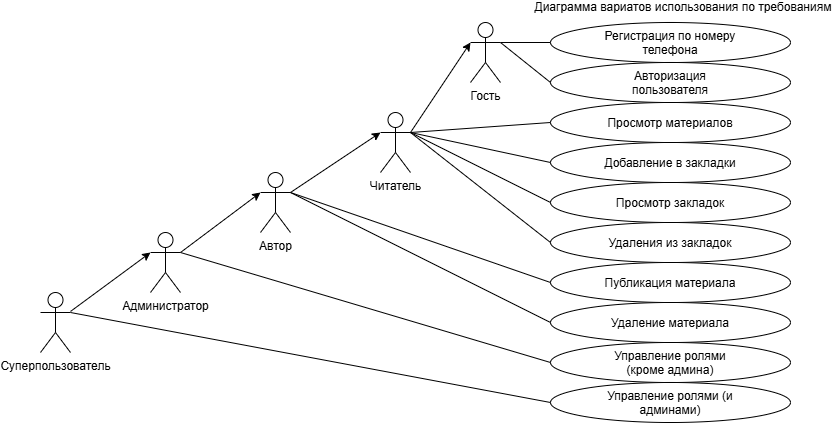

# Индивидуальный отчёт

**Проект:** портал образовательных материалов  
**Разработчик:** Гринь Вероника  
**Согласовано с:** Храмов Дмитрий Эдуардович  
**Роль в команде:** Backend-разработчик  
**Учётная запись на площадке:** nikolyyya  
**Репозиторий:** [https://github.com/donsgipsy/library-university](https://github.com/donsgipsy/library-university)

## 1. Задача

Описать цикл работы с закладками: добавление материала, просмотр списка и удаление; перенести результаты в Markdown-отчёт репозитория.

## 2. Связанные требования и варианты использования

| ID | Наименование |
| --- | --- |
| ФТ-4 | Работа с закладками |
| НФТ | Доступ к закладкам только у авторизованного пользователя с ролью «Читатель» и выше |

| ID | Вариант использования | Действующие лица |
| --- | --- | --- |
| UC-4.1 | Добавление материала в закладки | Читатель |
| UC-4.2 | Просмотр закладок | Читатель |
| UC-4.3 | Удаление материала из закладок | Читатель |

## 3. Требования (ПЗ 1)

### Функциональные требования

### ФТ-4. Работа с закладками

Система должна позволять Читателю управлять персональными закладками.

- Добавление материала в закладки одним нажатием.
- Просмотр списка всех сохранённых закладок с датой добавления.
- Переход к материалу из списка закладок.
- Удаление материала из закладок.
- Сортировка закладок по дате добавления или алфавиту.

### Нефункциональные требования

- **Адаптивность интерфейса:** веб-интерфейс системы должен быть реализован с использованием адаптивной верстки, обеспечивающей корректное отображение и полноценное функционирование всех основных элементов интерфейса на устройствах различных форм-факторов, включая настольные компьютеры, ноутбуки, планшеты и смартфоны. Размеры и расположение элементов интерфейса должны автоматически адаптироваться к ширине экрана устройства. На мобильных устройствах не должно требоваться горизонтальное прокручивание для работы с основным содержимым системы.

- **Кросс-браузерная совместимость:** система должна корректно работать в актуальных версиях основных веб-браузеров: Google Chrome, Mozilla Firefox, Microsoft Edge и Safari. Функциональность и отображение интерфейса должны сохраняться при использовании операционных систем Windows, macOS, Linux, iOS и Android. Использование конкретного браузера или операционной системы не должно приводить к потере доступа к основным функциям системы.

## 4. Варианты использования (ПЗ 2)

### UC-4.1. Добавление материала в закладки

**Описание:** Данный вариант использования описывает процесс добавления опубликованного материала в персональные закладки пользователя для быстрого доступа к нему в будущем.

**Действующие лица:** Читатель (зарегистрированный пользователь)

**Предусловия:**

- Пользователь авторизован в системе с ролью «Читатель» (или выше).
- В системе существуют опубликованные материалы, доступные пользователю.

**Основной поток (добавление в закладки):**

1. Читатель открывает страницу опубликованного материала (статьи).
2. Система отображает содержимое материала и кнопку «Добавить в закладки» (иконка закладки).
3. Читатель нажимает кнопку «Добавить в закладки».
4. Система проверяет, что данный материал ещё не добавлен в закладки пользователя.
5. Система сохраняет запись о закладке, связывая идентификатор пользователя с идентификатором материала и сохраняя дату добавления.
6. Система изменяет отображение кнопки на «В закладках» (заполненная иконка).
7. Система отображает краткое уведомление: «Материал добавлен в закладки».

**Альтернативные потоки:**

#### A1. Материал уже в закладках

1. На шаге 4 система обнаруживает, что материал уже сохранён в закладках пользователя.
2. Система не создаёт дублирующую запись.
3. Система отображает сообщение: «Материал уже находится в ваших закладках».

#### A2. Пользователь не авторизован

1. Неавторизованный пользователь пытается добавить материал в закладки (например, через API или прямую ссылку).
2. Система не сохраняет закладку.
3. Система отображает сообщение: «Для добавления в закладки необходимо войти в систему» и предлагает перейти к форме авторизации.

**Постусловия:**

- Материал связан с учётной записью пользователя в списке закладок и доступен для быстрого доступа.
- Сам материал не изменяется.

**Диаграммы:** общая диаграмма вариантов использования.

### UC-4.2. Просмотр закладок

**Описание:** Данный вариант использования описывает процесс просмотра пользователем списка ранее сохранённых им материалов в персональном разделе «Мои закладки».

**Действующие лица:** Читатель (зарегистрированный пользователь)

**Предусловия:**

- Пользователь авторизован в системе с ролью «Читатель» (или выше).
- Пользователь находится в интерфейсе системы.

**Основной поток:**

1. Читатель переходит в раздел «Закладки» в личном кабинете.
2. Система отображает сохранённые закладки, отсортированные по дате добавления (сначала новые).
3. Для каждой закладки система отображает название материала, дату добавления и краткое описание.
4. Читатель выбирает интересующую закладку.
5. Система открывает страницу соответствующего материала.

**Альтернативные потоки:**

#### A1. Закладки отсутствуют

1. На шаге 2 система обнаруживает, что у пользователя нет сохранённых закладок.
2. Система отображает сообщение: «У вас пока нет сохранённых закладок. Добавьте материалы, нажав на иконку закладки на странице статьи».

#### A2. Материал удалён из системы

1. При просмотре закладок (шаг 2) один из сохранённых материалов был удалён из системы администратором или автором.
2. Система отображает такую закладку с пометкой: «Материал недоступен (удалён)».
3. Пользователь может удалить данную закладку (перейти к Варианту 3.3).

**Постусловия:**

- Пользователь ознакомился с сохранёнными материалами.
- Пользователь получил возможность быстрого перехода к выбранному материалу.

**Диаграммы:** общая диаграмма вариантов использования.

### UC-4.3. Удаление материала из закладок

**Описание:** Данный вариант использования описывает процесс удаления ранее сохранённого материала из персональных закладок пользователя.

**Действующие лица:** Читатель (зарегистрированный пользователь)

**Предусловия:**

- Пользователь авторизован в системе с ролью «Читатель» (или выше).
- В списке закладок пользователя присутствует хотя бы один материал.

**Основной поток:**

1. Читатель находится на странице материала, который добавлен в закладки, или в разделе «Мои закладки».
2. Читатель нажимает кнопку «Удалить из закладок» (заполненная иконка закладки) или кнопку «Удалить» рядом с элементом в списке закладок.
3. Система запрашивает подтверждение удаления: «Удалить материал из закладок?».
4. Читатель нажимает кнопку «Подтвердить».
5. Система удаляет запись о закладке из базы данных.
6. Система обновляет отображение: кнопка возвращается в состояние «Добавить в закладки» или элемент исчезает из списка закладок.
7. Система отображает уведомление: «Материал удалён из закладок».

**Альтернативные потоки:**

#### A1. Отмена удаления закладки

1. На шаге 4 читатель нажимает кнопку «Отмена» в диалоге подтверждения.
2. Система не удаляет закладку.
3. Закладка остаётся в списке, отображение не изменяется.

**Постусловия:**

- Связь между пользователем и материалом в списке закладок удалена.
- Сам материал не изменяется и не удаляется из системы.
- Пользователь может продолжить работу с порталом.

**Диаграммы:** общая диаграмма вариантов использования.

## 5. Принятые решения

- Одна ФТ-4 разбита на три UC по действиям: добавление, просмотр, удаление.
- Дубликаты закладок не создаются (UC-4.1, A1); закладка хранит связь «пользователь – материал» и дату добавления.
- Список закладок по умолчанию сортируется от новых к старым; удалённые материалы показываются с пометкой «Материал недоступен» (UC-4.2, A2), что согласуется с UC-6.2 Хоптяной Марии.
- Перед удалением закладки запрашивается подтверждение; отмена оставляет данные без изменений (UC-4.3, A1).

## 6. Результат

- Описание UC-4.1, UC-4.2, UC-4.3 (основной и альтернативные потоки, пред- и постусловия).
- Участие UC-4.1–4.3 на общей диаграмме вариантов использования (рисунок 1).



## 7. Проверка

- Идентификатор ФТ-4 и UC-4.1–4.3 совпадают с ПЗ 1 и ПЗ 2.
- Поведение при удалении материала сверено с UC-6.2 (пометка закладок других пользователей как недоступных).
- Сортировка и поля списка закладок сверены с пунктами ФТ-4.

## 8. Вклад в работу команды

Подготовка разделов общего отчёта docs/README.md по UC-4.1–4.3 (закладки).

Связанные материалы: [общий отчёт](../README.md).

## 9. Программная реализация модуля закладок

В рамках реализации ФТ-4 разработан самостоятельный backend-модуль закладок на Python с использованием SQLite. Модуль обеспечивает хранение закладок пользователей, добавление новых записей, получение списка закладок и удаление сохранённых материалов.

### 9.1. Структура модуля

Для разделения ответственности программная реализация организована на несколько компонентов:

- **Bookmark (model.py)** — модель закладки, содержащая идентификатор записи, идентификатор пользователя и идентификатор материала.
- **Database (database.py)** — компонент для создания подключения к базе данных SQLite и формирования таблицы `bookmarks`.
- **BookmarkRepository (repository.py)** — слой доступа к данным, отвечающий за выполнение SQL-запросов.
- **BookmarksService (service.py)** — сервисный слой, содержащий бизнес-логику и проверки входных данных.
- **test_bookmarks.py** — модуль автоматического тестирования функциональности закладок.

### 9.2. Реализация базы данных

Для хранения закладок создана таблица `bookmarks` со следующими полями:

| Поле | Тип | Назначение |
|---|---|---|
| id | INTEGER | Первичный ключ с автоматическим увеличением |
| user_id | INTEGER | Идентификатор пользователя |
| material_id | INTEGER | Идентификатор учебного материала |
| created_at | TEXT | Дата и время создания закладки |

Для предотвращения повторного добавления одного и того же материала одним пользователем предусмотрено ограничение `UNIQUE(user_id, material_id)`.

Также включена поддержка внешних ключей SQLite через `PRAGMA foreign_keys = ON`.

### 9.3. Реализация репозитория

В `BookmarkRepository` реализованы методы взаимодействия с базой данных:

- `add(user_id, material_id)` — добавление записи о закладке.
- `get_user_id(user_id)` — получение закладок конкретного пользователя.
- `exists(user_id, material_id)` — проверка наличия конкретной закладки.
- `remove(user_id, material_id)` — удаление записи о закладке.

Для добавления и удаления используются SQL-запросы `INSERT` и `DELETE`. Для проверки существования закладки используется `SELECT EXISTS`.

Репозиторий отделяет работу с SQL от бизнес-логики сервиса.

### 9.4. Реализация сервисного слоя

В `BookmarksService` реализованы три основных метода:

- `add_bookmark(user_id, material_id)` — проверяет корректность идентификаторов, проверяет наличие дубликата и передаёт команду на добавление записи в репозиторий.
- `get_user_bookmarks(user_id)` — проверяет идентификатор пользователя и возвращает список его закладок.
- `remove_bookmark(user_id, material_id)` — проверяет идентификаторы и удаляет соответствующую закладку.

Для идентификаторов предусмотрена проверка типа данных: допускаются только положительные целые числа, значения типа `bool` не принимаются.

При повторном добавлении закладки или попытке удалить несуществующую закладку генерируется исключение `ValueError`.

### 9.5. Тестирование

Для проверки корректности работы модуля подготовлены автоматические тесты с использованием стандартной библиотеки Python `unittest`.

Для тестирования используется отдельная временная база SQLite в оперативной памяти, что позволяет проверять работу модуля без изменения основной базы данных.

Предусмотрены проверки следующих сценариев:

- добавление новой закладки;
- повторное добавление уже существующей закладки;
- получение списка закладок пользователя;
- получение пустого списка, если у пользователя нет закладок;
- удаление существующей закладки;
- попытка удаления несуществующей закладки;
- передача отрицательного или некорректного идентификатора пользователя;
- передача отрицательного или некорректного идентификатора материала.

Для запуска тестов используется команда:

```bash
python -m unittest discover -s tests -v
```

### 9.6. Документация

Для модуля подготовлен файл `README.md`, содержащий описание назначения модуля, его структуры, используемых технологий, схемы базы данных, основных методов и инструкции по запуску автоматических тестов.

### 9.7. Результат программной реализации

В результате разработан самостоятельный backend-модуль, реализующий основные операции управления закладками: добавление, получение списка и удаление. Реализовано разделение на модель, слой доступа к данным и сервисный слой. Предусмотрены проверки входных данных и защита от дублирования записей на уровне приложения и базы данных.

