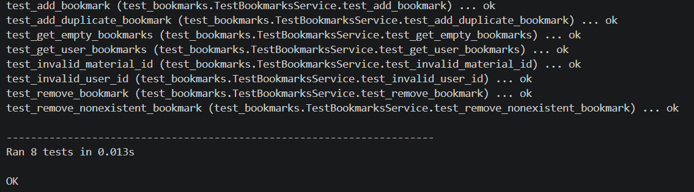

# Модуль закладок (Bookmarks)

## Описание

Модуль закладок предназначен для управления сохранёнными учебными материалами пользователей библиотеки.

Он позволяет добавлять материалы в закладки, получать список закладок конкретного пользователя и удалять сохранённые материалы.

Для хранения данных используется SQLite.

## Функциональные возможности

- **Добавление закладки** — сохранение связи между пользователем и учебным материалом.
- **Получение закладок пользователя** — вывод всех материалов, добавленных конкретным пользователем.
- **Удаление закладки** — удаление сохранённого материала.
- **Проверка данных** — проверка корректности идентификаторов пользователя и материала.
- **Защита от дубликатов** — один пользователь не может добавить один и тот же материал в закладки несколько раз.

## Структура модуля

```text
bookmarks/
│
├── model.py          # Модель закладки
├── database.py       # Подключение к SQLite и создание таблицы
├── repository.py     # Работа с базой данных
├── service.py        # Бизнес-логика модуля
│
└── tests/
    ├── __init__.py
    └── test_bookmarks.py  # Автоматические тесты
```

## Технологии

- Python 3
- SQLite3
- unittest

## Структура базы данных

Для хранения закладок используется таблица `bookmarks` со следующими полями:

| Поле | Тип | Описание |
|---|---|---|
| id | INTEGER | Первичный ключ, автоинкремент |
| user_id | INTEGER | Идентификатор пользователя |
| material_id | INTEGER | Идентификатор материала |
| created_at | TEXT | Дата и время создания закладки |

Для предотвращения дублирования используется ограничение `UNIQUE(user_id, material_id)`.

## Основные методы

### BookmarksService

- `add_bookmark(user_id, material_id)` — добавляет материал в закладки пользователя.
- `get_user_bookmarks(user_id)` — возвращает список закладок пользователя.
- `remove_bookmark(user_id, material_id)` — удаляет закладку пользователя.

### BookmarkRepository

- `add(user_id, material_id)` — сохраняет закладку в базе данных.
- `get_user_id(user_id)` — получает закладки пользователя.
- `exists(user_id, material_id)` — проверяет наличие закладки.
- `remove(user_id, material_id)` — удаляет закладку из базы данных.

## Обработка ошибок

Модуль проверяет корректность идентификаторов пользователя и материала. Идентификаторы должны быть положительными целыми числами.

При попытке повторно добавить существующую закладку или удалить несуществующую закладку возникает ошибка `ValueError`.

## Запуск тестов

Для запуска автоматических тестов необходимо перейти в корневую папку модуля `bookmarks`:

```bash
cd /library-university/modules/bookmarks
```

Выполнить команду:

```bash
python3 -m unittest discover -s tests -v
```

Тесты проверяют:
- добавление закладок;
- защиту от дублирования;
- получение списка закладок;
- получение пустого списка;
- удаление закладок;
- обработку некорректных идентификаторов;
- обработку удаления несуществующей закладки.

Результаты тестов:


Для тестирования используется временная база SQLite в оперативной памяти, поэтому основная база данных не изменяется.
