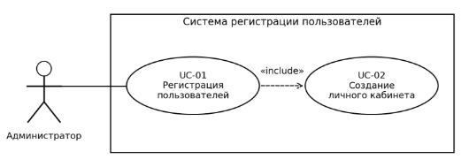
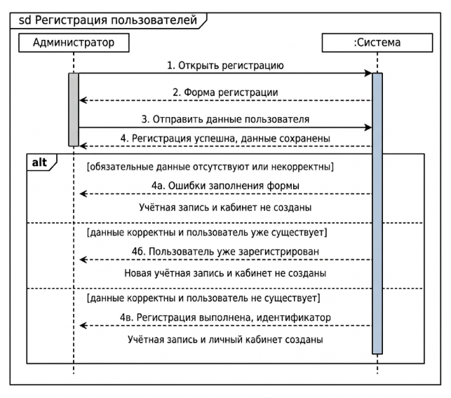
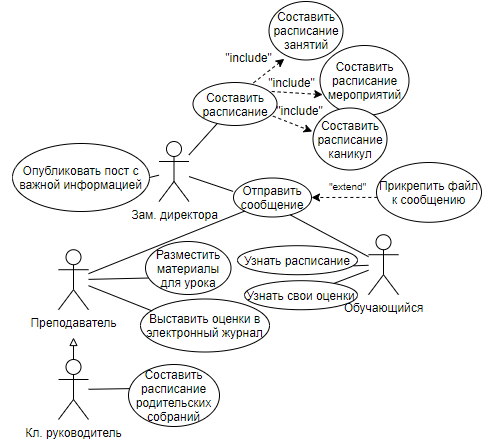
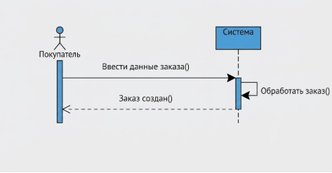
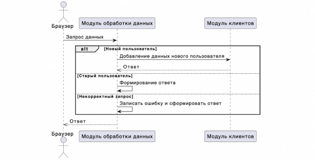

**Практическое задание 3,5. Программная инженерия.**

**Построение и оформление UML диаграмм\
вариантов использования и последовательностей**

# **Цель работы**

Освоить построение диаграммы вариантов использования и диаграммы последовательностей UML, научиться отображать участников и функции системы, порядок взаимодействия и альтернативные сценарии, а также проверять согласованность диаграмм с требованиями и текстовыми описаниями.

# **Задачи работы**

\1) Продолжить работу над программным продуктом, выбранным в ПЗ № 1, используя варианты использования, подготовленные в ПЗ № 2\.

\2) Определить границы системы, действующих лиц и их связи с вариантами использования\. Построить общую диаграмму команды\.

\3) Каждому участнику построить диаграмму последовательностей для своего варианта использования из ПЗ № 2: основной поток и не менее одного альтернативного потока\.

\4) Обосновать выбранные связи и условия ветвления; проверить соответствие диаграмм текстовым сценариям\.

\5) Провести взаимную проверку, исправить выявленные несоответствия и дополнить общий отчёт команды\.
**\

# **Краткая теория**

UML (Unified Modeling Language – унифицированный язык моделирования) позволяет описывать систему с помощью диаграмм. Разные виды диаграмм отвечают на разные вопросы и дополняют друг друга.

Диаграмма вариантов использования показывает, кто взаимодействует с системой и какие возможности она предоставляет. Диаграмма последовательностей показывает, какими сообщениями обмениваются участники при выполнении конкретного сценария.

В этой работе моделируется та же система, что и в ПЗ № 1–2. Новые функции нельзя добавлять только ради усложнения рисунка: сначала их необходимо согласовать и внести в требования.

## **Диаграмма вариантов использования**

Актор – внешняя по отношению к системе роль человека либо другой системы. Один человек может выполнять несколько ролей. Актор обозначается фигурой человека с подписью.

Граница системы изображается прямоугольником с её названием. Варианты использования располагаются внутри, акторы – снаружи. Внутренняя база данных не является актором разрабатываемой системы.

Вариант использования изображается овалом; его название соответствует ПЗ № 2 и выражает цель. Отдельные щелчки мышью и поля формы не являются вариантами использования.

Ассоциация – сплошная линия между актором и вариантом использования. В этой работе используйте линии без стрелок: они показывают участие, а не порядок действий.

Связь «include» обозначает включение поведения другого варианта использования. Пунктирная стрелка с открытым наконечником направлена от включающего варианта к включаемому. Пример: успешная регистрация из ПЗ № 2 включает создание личного кабинета.

Связь «extend» обозначает дополнительное поведение в заданной точке расширения. Пунктирная стрелка направлена от расширяющего варианта к базовому. Базовый вариант должен иметь смысл без расширения. Укажите условие и точку расширения. Например, «Применение промокода» расширяет «Оформление заказа» при наличии промокода на этапе расчёта стоимости.

Обобщение – сплошная линия с незакрашенным треугольником от частной роли к общей. Частная роль должна поддерживать все взаимодействия общей роли.

Связи «include», «extend» и обобщение добавляются только при наличии оснований. Показывать все виды связей необязательно.

**Рисунок 1 – Фрагмент диаграммы по примеру из ПЗ № 2**

## **Диаграмма последовательностей**

Диаграмма последовательностей (Sequence Diagram) описывает обмен сообщениями в рамках выбранного сценария. Участники располагаются сверху, линии жизни идут вертикально вниз, сообщения – между линиями жизни. Порядок событий читают сверху вниз; расстояние между стрелками не задаёт точное время.

Для этой работы используйте системный уровень: актор взаимодействует с системой как с единым участником. Внутренние классы, сервисы и базу данных выделять не требуется. Это соответствует описаниям ПЗ № 2, где фиксируется поведение системы, а не устройство программного кода.

## **Основные обозначения**

\1) Участник – подписанный элемент вверху диаграммы\. Для системы допустима запись «:Система»; вместо общего слова можно указать название вашего продукта\.

\2) Линия жизни – вертикальная пунктирная линия под участником\. Не обозначайте ею связь между участниками\.

\3) Синхронный запрос – сплошная стрелка с закрашенным треугольным наконечником: отправитель ожидает завершения вызова\. Подпишите действие и существенные данные, например «Отправить заявку(данные)»\.

\4) Ответ на запрос – пунктирная стрелка с открытым наконечником в обратном направлении\. Подпишите результат, например «Заявка создана, номер»\. Не все ответы обязательны в UML, но значимые результаты в этой работе нужно показать\.

\5) Полоса активации – узкий прямоугольник на линии жизни, обозначающий выполнение поведения\. В системных диаграммах этой работы её можно опустить\. Если используете, связывайте её начало и конец с соответствующими запросами и ответами\.

\6) Фрагмент alt – рамка для взаимоисключающих ветвей\. Разделите области пунктиром; в каждой укажите условие в квадратных скобках\. Например: [места есть] и [мест нет]\.

\7) Фрагмент opt содержит один необязательный участок с условием\. Фрагмент loop обозначает повторение и должен иметь условие продолжения либо число повторов\. Добавляйте их только по смыслу сценария\.

Для альтернативного потока укажите причину, реакцию системы и итог. Если после ошибки предусмотрена повторная отправка данных, покажите её через loop либо явно обозначьте, что диаграмма охватывает только одну попытку.

## **Пример диаграммы последовательностей**

Вариант использования «Регистрация пользователей» взят из ПЗ № 2. Предусловие: администратор уже вошёл в систему и имеет право регистрировать пользователей. Показана одна попытка отправки формы; повторное исправление и отправка данных находятся за пределами этого рисунка.

**Рисунок 2 – Регистрация пользователя с альтернативными потоками**

После сообщения 3 система проверяет заполнение и корректность данных, затем отсутствие дубликата. Ветвь 4а объединяет альтернативы A2 и A3 из ПЗ № 2; ветвь 4б соответствует A1. Только ветвь 4в приводит к созданию учётной записи, присвоению идентификатора и созданию личного кабинета.

Сообщения 4а, 4б и 4в – альтернативные ответы на один запрос, а не три последовательных ответа. Поясняющие надписи о состоянии системы не являются сообщениями. Критерий дубликата необходимо уточнить у заказчика: совпадение ФИО само по себе не доказывает, что это один человек.

# **Порядок выполнения работы**

\1) Откройте требования ПЗ № 1 и сценарии ПЗ № 2\. Проверьте названия ролей\. Присвойте идентификаторы требованиям (ФТ-01 и далее) и вариантам использования (UC-01 и далее)\.

\2) Составьте перечень акторов и доступных им сценариев\. Одним предложением определите границы системы\.

\3) Постройте общую диаграмму вариантов использования команды\. Разместите границу системы, акторов, овалы и ассоциации\. Рассмотрите необходимость «include», «extend» и обобщения; объясните каждую добавленную связь\.

\4) Каждый участник выбирает свой сценарий из ПЗ № 2\. До построения диаграммы последовательностей выпишите: отправителя, получателя, содержание сообщения и соответствующий шаг сценария\. Выберите как минимум один содержательный альтернативный поток\.

\5) Постройте диаграмму последовательностей: участники, линии жизни, запросы и ответы, ветви alt\. Укажите предусловия, условия ветвей и результат\. Сохраняйте системный уровень детализации на всей диаграмме\.

\6) Передайте диаграмму другому участнику\. Он проверяет оба потока и постусловия по ПЗ № 2\. Запишите замечания и исправления; при отсутствии замечаний перечислите проверенные условия\.

\7) Дополните отчёт диаграммами, пояснениями и результатами проверки\. Укажите авторов\. Согласуйте изменения требований и сценариев с преподавателем\.

## **Построение в редакторе**

Можно использовать draw.io (diagrams.net), можно и другой редактор с обозначениями UML. Для draw.io откройте https://app.diagrams.net/, создайте пустую диаграмму и сохраните её на устройство. В панели фигур выберите «Больше фигур» (More Shapes), включите UML и UML 2.5, затем нажмите «Применить» (Apply).

Создайте отдельные страницы для диаграммы вариантов использования и каждой диаграммы последовательностей. Перетаскивайте фигуры, задавайте подписи двойным щелчком, проверяйте тип линии и наконечники. Для alt используйте рамку Frame, разделители и условия в квадратных скобках.

Сохраните файл .drawio. Через «Файл → Экспортировать как» получите PNG или SVG, вставьте в отчёт и проверьте читаемость. При недоступности веб-редактора используйте установленный редактор; бумажный черновик перенесите в электронный вид.

## **Построение диаграммы в PlantUML**

Дополнительное зажание, построить диаграмму через тактовое описание.  Ест такая программа – PlantUML, которая строит диаграмму по текстовому описанию. Можно использовать его вместо графического редактора. Ниже показана одна попытка регистрации: администратор уже вошёл в систему, обязательные поля заполнены корректно; рассматривается проверка дубликата.

\1) Откройте редактор по ссылке ниже и замените демонстрационный текст приведённым кодом\. Если изображение не обновилось автоматически, нажмите кнопку отправки или обновления диаграммы\.

Редактор: <https://www.plantuml.com/plantuml/uml/>

Листинг 1 – Пример кода в UML.

@startuml\
title Регистрация пользователя\
autonumber\
actor "Администратор" as Admin\
participant "Система" as System\
Admin -> System: Отправить данные пользователя\
activate System\
alt [пользователь уже существует]\
`    `System -->> Admin: Отказ: пользователь уже зарегистрирован\
else [пользователь не существует]\
`    `note right of System\
`      `Созданы учётная запись и личный кабинет\
`    `end note\
`    `System -->> Admin: Регистрация выполнена, идентификатор\
end\
deactivate System\
@enduml

\2) Прочитайте результат сверху вниз\. as задаёт короткое имя участника; -> обозначает запрос, -->> – ответ\. alt/else разделяет ветви, end закрывает блок\. activate/deactivate показывает период выполнения, note – примечание\. autonumber нумерует сообщения, но не задаёт порядок выполнения альтернативных ветвей\.

\3) Адаптируйте код под свой UC из ПЗ № 2: замените роли, сообщения и условия\. Объясните результат каждой ветви\. Сохраните исходный текст в UTF-8 с расширением \.puml и изображение в PNG или SVG\. Вставьте изображение в отчёт; исходник приложите к работе\.

Справка: <https://plantuml.com/ru/sequence-diagram>

Дополнительный материал: <https://habr.com/ru/companies/X5Tech/articles/821687/>

## **Требования к выполнению и оформлению**

\1) Команда представляет одну общую диаграмму вариантов использования\. Она охватывает согласованные функции проекта\. Искусственно увеличивать число акторов и овалов не требуется\.

\2) Каждый участник представляет минимум одну собственную диаграмму последовательностей для своего сценария ПЗ № 2\. На ней должны быть основной поток и хотя бы одна альтернативная ветвь с условием и результатом\.

\3) Названия акторов и вариантов использования совпадают во всех материалах\. Каждая диаграмма последовательностей связана с конкретным UC; каждый UC – хотя бы с одним функциональным требованием\.

\4) На диаграмме вариантов использования отсутствуют стрелки «сначала – потом»\. Ошибка ввода обычно остаётся альтернативным потоком и не становится отдельным вариантом использования только ради связи «extend»\.

\5) Стрелки соединяют нужных участников, имеют понятные подписи и правильные наконечники\. Условия alt не противоречат друг другу; успешное сохранение не выполняется в ветви отказа\.

\6) Рисунки имеют номера и содержательные подписи; под индивидуальной диаграммой указаны UC и ФИО автора\. Используйте единый язык подписей, одинаковые размеры шрифтов и контрастные линии\.

\7) Диаграммы должны читаться при обычном просмотре отчёта\. Не допускаются наложения, обрезанные подписи и скриншоты с панелями редактора\. Если схема не помещается, используйте отдельную альбомную страницу или разделите её на связанные фрагменты\.

\8) Сдавайте обновлённый общий отчёт в DOCX и редактируемые исходники диаграмм\. Одних изображений без исходников и пояснений недостаточно\.

## **Проверка проблемной ситуации**

В учебном черновике регистрации актор «Администратор» находится внутри границы системы, внутренняя база данных изображена как внешний актор, а от «Авторизации» к «Регистрации» проведена сплошная стрелка с подписью «потом». На диаграмме последовательностей сообщение «Пользователь создан» расположено до проверки дубликата, а после ветви [пользователь существует] выполняется создание кабинета.

Найдите и объясните все пять ошибок. Для каждой запишите исправление и его причину. Учитывайте предусловие ПЗ № 2: администратор уже вошёл в систему. Затем проверьте свои диаграммы на аналогичные ошибки и отразите результат в отчёте.

# **Содержание отчёта**

Продолжайте общий отчёт, начатый в Предыдущей. Обновите на титульном листе номер отчёта и состав команды. Сохраните предыдущие задания; при изменении требований или сценариев внесите согласованные исправления и кратко перечислите их.

\1) Цель работы, название системы и описание её границ\.

\2) Общая диаграмма вариантов использования и краткое обоснование специальных связей либо их отсутствия\.

\3) Индивидуальные диаграммы последовательностей: Use Case, автор, предусловия, охваченные потоки и пояснения к условиям ветвления\.

\4) Таблица соответствия по приведённому ниже образцу\. Для Use Case, которые пока не раскрыты диаграммой последовательностей, укажите «не строилась в ПЗ № 3»\.

\5) Разбор пяти ошибок, результаты взаимной проверки и внесённые исправления\.

\6) Краткий вывод: какие неточности обнаружены при переводе текста в диаграммы и как они устранены\.

**Таблица 1 – Таблица для оформление отчета** 

|**Требование**|**Вариант использования**|**Диаграмма и потоки**|**Автор**|
| :- | :- | :- | :- |
|ФТ-01|UC-01 Регистрация пользователей|SD-01; основной, A1–A3|ФИО студента|

Строка таблицы – пример заполнения; в отчёте используйте идентификаторы и данные своего проекта.

# **Вопросы для защиты**

\1) Чем диаграмма вариантов использования отличается от диаграммы последовательностей?

\2) Почему актор находится вне системы? Чем роль отличается от конкретного человека?

\3) Куда направлены стрелки «include» и «extend»? Почему они не обозначают порядок действий?

\4) Какому шагу ПЗ № 2 соответствует выбранное сообщение? Что происходит при невыполнении условия успешной ветви?

\5) Какие постусловия достигаются после успеха и какое состояние остаётся после отказа?

## **Справочные материалы**

OMG UML 2.5.1: <https://www.omg.org/spec/UML/2.5.1>

Документация draw.io: <https://www.drawio.com/docs/diagram-types/uml/>

# **Дополнительный пример диаграммы вариантов использования**

Пример информационной системы школы позволяет рассмотреть несколько ролей и связи между вариантами использования. При разборе найдите общие возможности пользователей и объясните, почему роль классного руководителя является специализацией роли преподавателя.

**Рисунок 3 – Варианты использования информационной системы школы**

При разборе явно обозначьте границу системы. Для расширения отправки сообщения определите условие прикрепления файла и точку расширения. Наличие связи на готовом рисунке само по себе не заменяет её обоснование.
**\

## **Дополнительное чтение**

В статье Яндекс Практикума об UML можно сопоставить разные типы диаграмм. Для этой работы нужен раздел о диаграммах сценариев использования; его схема онлайн-покупок может служить альтернативой рисунку 3.

Яндекс Практикум: <https://practicum.yandex.ru/blog/uml-diagrammy/>

# **Дополнительные примеры диаграмм последовательностей**

**Рисунок 4 – Обмен сообщениями при создании онлайн-заказа**

**Рисунок 5 – Альтернативные ветви взаимодействия**

При чтении дополнительных материалов различайте UML и синтаксис PlantUML. Асинхронный вызов означает, что отправитель продолжает работу, не ожидая завершения обработки; отдельное ответное сообщение при этом возможно. Уничтожение объекта не равно простому окончанию показанного сценария.
